# Architecture Deep-Dive

> The full story behind Mini-Ticketmaster — what each piece does, why it exists, and what failure it prevents.

This document complements the [README](../README.md). The README is the project landing page; this is the engineering manual. **§1–§13 explain the design**, **§14 is a per-file reference** for when you need to find or modify a specific file.

**Code state reflected:** through Layer 1 of [`product-roadmap.md`](./product-roadmap.md) (5/5 items shipped). The core system (original Phases 0–9) and the observability stack (Phases 10–13) are landed and unchanged on top of it. Two milestone commits sit above those:

| Milestone | Branch | What |
|---|---|---|
| Dockerization | `feature/dockerize-go-services` | All 4 long-running Go services (api, worker, expiration-watcher, dashboard-server) moved from host into Docker. Shared parameterized `Dockerfile` (distroless/static, `SERVICE` build arg → binary at constant path `/app/server`). `docker-compose.yml` grew from 8 → **12 services**. `LOG_FILE` env support added to `internal/logging`. Prometheus scrape targets switched from `host.docker.internal` → service names. `.env.docker.example` + `scripts/setup-docker-env.sh` (idempotent, migrates the host `.env`'s `JWT_SECRET`). |
| Layer 1 — the product surface | `feature/get-reservations` → `feature/cancel-reservation` → `feature/readyz` → `feature/idempotency-key` | 5 items, one branch each (linear chain): typed state-machine helper + read endpoints + cancel endpoint + `/readyz` + `Idempotency-Key` on `/reserve`. Layer 1 is what turns the core reservation machinery into something a user can actually operate. See [`product-roadmap.md`](./product-roadmap.md) for the item-by-item breakdown. |

**What Layer 1 added at a glance:**

- `internal/db/transition.go` — `TransitionStatus(ctx, pool, id, from, to, audit) (changed, err)`, a CAS UPDATE backed by a `validTransitions` map, writing the audit row in the same transaction. The single gateway for every status change in the system.
- `internal/db/audit.go` — the audit trail's types and writers: `Audit` / `AuditActor` / `AuditEntry`, `WriteAuditEvent` (standalone INSERT), `AuditInsertSelect` (the data-modifying-CTE form the expire paths use), and `auditEventTypeForEdge` (edge → event type).
- `GET /api/reservations/{id}` and `GET /api/me/reservations` — users can look up their own tickets (JWT-scoped, paginated, status-filterable).
- `POST /api/reservations/{id}/cancel` — user-initiated cancel; CAS-safe against the watcher's EXPIRED sweep; releases the seat back to Redis; best-effort hold-key cleanup.
- `GET /readyz` — three parallel dependency checks (Redis / Postgres / SQS) with 500ms per-check budgets. `200` if all green, `503` otherwise. Distinct from `/healthz` (process-alive only).
- `Idempotency-Key` on `POST /reserve` — safe retries. 24h cached response replay + a short-TTL SETNX in-flight lock so parallel retries don't double-book.

The headline test (`loadtest/burst.js`, 1000 VUs, event_id=1, inv=100) still produces exactly 100 × 200 + 900 × 409 — and now every one of those requests shows up in all three observability sinks, joined by `trace_id`. See §14 for the story.

---

## Table of Contents

1. [System Overview](#1-system-overview)
2. [The 3-Phase Gatekeeper](#2-the-3-phase-gatekeeper)
3. [Phase 1 — Virtual Waiting Room](#3-phase-1--virtual-waiting-room)
4. [Phase 2 — Atomic Seat Locking](#4-phase-2--atomic-seat-locking)
5. [Phase 3 — Asynchronous Fulfillment](#5-phase-3--asynchronous-fulfillment)
6. [TOCTOU and Why Lua Fixes It](#6-toctou-and-why-lua-fixes-it)
7. [The Two-State Model](#7-the-two-state-model)
8. [Reservation Lifecycle](#8-reservation-lifecycle)
9. [Handling Expirations](#9-handling-expirations)
10. [Why SQS Standard (Not FIFO)](#10-why-sqs-standard-not-fifo)
11. [Failure Modes & Mitigations](#11-failure-modes--mitigations)
12. [Known Development Sharp Edges](#12-known-development-sharp-edges)
13. [The Observability Pillar](#13-the-observability-pillar)
14. [File-by-File Reference](#14-file-by-file-reference)

---

## 1. System Overview

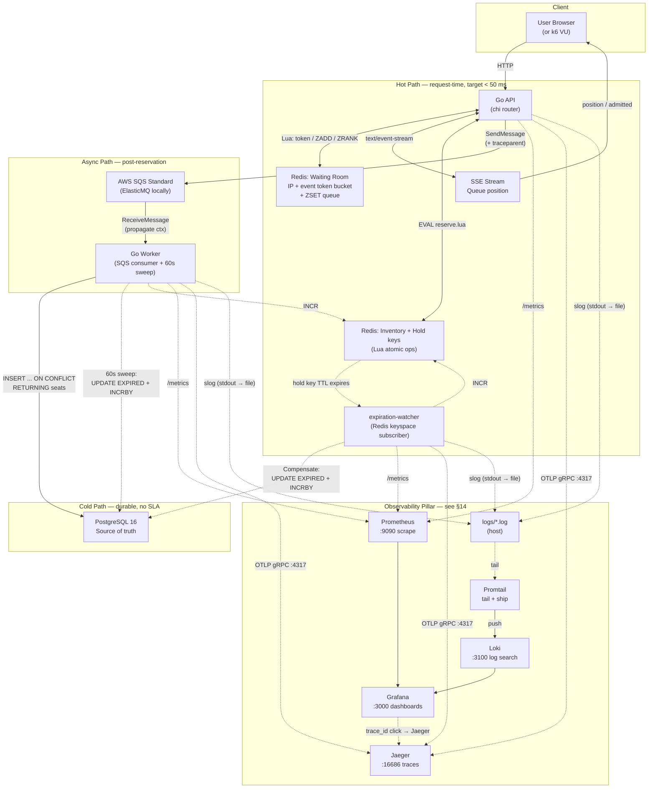

**Four latency tiers, each with its own SLA:**

| Tier      | Components                 | Target          | Why                                                    |
| ----------- | ---------------------------- | ----------------- | -------------------------------------------------------- |
| **Hot**   | API ↔ Redis               | < 50 ms         | User is waiting for a seat; every ms matters           |
| **Async** | API → SQS                 | < 10 ms publish | Only needs to enqueue; the user already has their seat |
| **Watch** | watcher ↔ Redis keyspace  | ~ real-time     | Catch expiries as they fire                            |
| **Cold**  | Worker → Postgres (sweep) | every 60 s      | Safety net for missed keyspace events                  |

The cardinal rule: **Postgres never touches the hot path.** This is the design constraint that shapes every decision below.

The observability layer is **a side-channel, not part of the request path.** The hot path is unchanged — every observability wire on the right is sampled/buffered locally and shipped to a side system. A failure in Promtail, Loki, or even the whole Jaeger OTLP exporter does not affect a single user request. (See §14.6 for the "trace_id is the join key" story that makes all three sinks queryable as one.)

---

## 2. The 3-Phase Gatekeeper

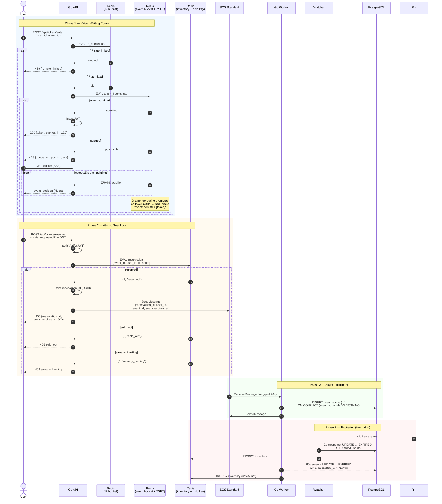

Each phase solves a different problem and they compose:

- **Phase 1** keeps Phase 2 from being overwhelmed (and blocks bulk bots via the IP tier)
- **Phase 2** keeps Phase 3's queue from being flooded with "almost-winners"
- **Phase 3** keeps the user-facing response time independent of Postgres latency
- **Phase 7** returns inventory when a hold expires, by either event-driven (fast) or DB-sweep (safe) path

---

## 3. Phase 1 — Virtual Waiting Room

**Goal:** shed load *before* it reaches the inventory layer. The unique wrinkle vs. naive rate limiting is the **two-tier gate**: a per-IP bucket kills bulk abuse; a per-event bucket handles legitimate burst.

### Two-tier admission

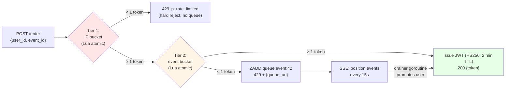

**Why two tiers?** A per-IP bucket is cheaper than a per-event bucket to evaluate, but it can't be the only defense — one attacker with 10,000 residential IPs would each get the full burst. The per-event bucket caps *total* admission regardless of attacker count.

### Tier 1: IP bucket (`internal/iplimit/scripts/ip_bucket.lua`)

Classic lazy-refill token bucket:

- State per IP: Redis Hash `{tokens, last_refill_ms}` (one key per IP, e.g. `ip:1.2.3.4`)
- On call: compute elapsed time → refill `tokens = min(capacity, tokens + elapsed * refill_rate)` → consume one if available
- 1-day TTL on the bucket state (safety net against stale entries)
- **Hard reject** on exhaustion — no queue, no fairness for bots

### Tier 2: Event bucket + ZSET queue (`internal/redis/scripts/token_bucket.lua`)

Same shape, but with an overflow queue:

- State per event: Redis Hash `{tokens, last_refill_ms}` (key: `bucket:event:42`)
- Queue: Redis ZSET (key: `queue:event:42`), scored by **nanosecond timestamp** for fairness
- On call: refill → consume if available; else `ZREMRANGEBYSCORE` to drop stale entries, `ZADD now user`, return 1-based position
- Queue TTL is refreshed on every insert (track current and stale)

### The drainer goroutine (`internal/waitingroom/drainer.go`)

A long-lived goroutine in the API process. Lazily spawns one sub-loop per event that currently has a queue; sub-loop exits after 5 minutes of empty queue.

Every tick (100 ms):

1. `ZCARD queue:event:42` — how many people waiting?
2. Compute `tokensToAdd = refill_rate * tick_interval` (capped at queue size, floor of 1)
3. For each token: `ZPOPMIN` (FIFO), `Issue` JWT, `Deliver` to the user's SSE channel

The drainer and the SSE goroutines communicate via an in-process `map[eventID:userID]chan string` (`internal/waitingroom/queue.go`). At Phase 4 scale (thousands, not millions) an in-process registry is simpler and faster than Redis pub/sub.

### SSE position updates

When queued, the user receives `429 {queue_url}` and opens an SSE stream:

```
GET /api/tickets/queue?event_id=42&user_id=alice HTTP/1.1
Accept: text/event-stream
```

```
HTTP/1.1 200 OK
Content-Type: text/event-stream

event: position
data: {"position": 137, "eta_seconds": 14}

event: position
data: {"position": 98, "eta_seconds": 10}

event: admitted
data: {"token": "eyJhbGciOiJIUzI1NiIs..."}
```

The handler runs a goroutine that listens on three things at once (`select{}`): the admission channel, a 15-second heartbeat ticker (re-reads `ZRANK` to keep the position fresh), and the request context (fires when the client disconnects).

**Why SSE, not WebSockets?** Data flows one way: server → client. SSE is plain `HTTP/1.1`, auto-reconnects on the client, works through every proxy, and needs zero framing/upgrade ceremony — WebSockets would add framing, masking, ping/pong, and a separate handshake for no benefit.

---

## 4. Phase 2 — Atomic Seat Locking

**Goal:** guarantee that exactly N seats are allocated for N requests, even with millisecond-level concurrency.

### The Lua reservation script (`internal/redis/scripts/reserve.lua`)

```lua
-- KEYS[1] = seat_inventory_key   e.g. "inventory:event:42"
-- KEYS[2] = user_hold_key        e.g. "hold:event:42:user:abc123"
-- ARGV[1] = hold_ttl_seconds     e.g. "600" (10 minutes)
-- ARGV[2] = seats_requested      e.g. "1" (max 10 — see API handler validation)

local available = tonumber(redis.call('GET', KEYS[1]))

if available == nil then
  return {-1, 'event_not_found'}        -- event was never seeded
end

local requested = tonumber(ARGV[2])
if available < requested then
  return {0, 'sold_out'}                -- not enough seats
end

-- Guard: same user can't double-book within their hold TTL
local existing_hold = redis.call('GET', KEYS[2])
if existing_hold then
  return {0, 'already_holding'}
end

redis.call('DECRBY', KEYS[1], requested)            -- commit the decrement
redis.call('SET', KEYS[2], ARGV[2], 'EX', ARGV[1])   -- hold key TTL + seats count

return {1, 'reserved'}
```

**Execution time:** ~50 µs on a single Redis node. Out of 1,000 requests racing for 10 seats, exactly 10 return `{1, "reserved"}`. The other 990 get `{0, "sold_out"}` in microseconds — **no DB call ever happens**.

### Why Redis Lua is atomic

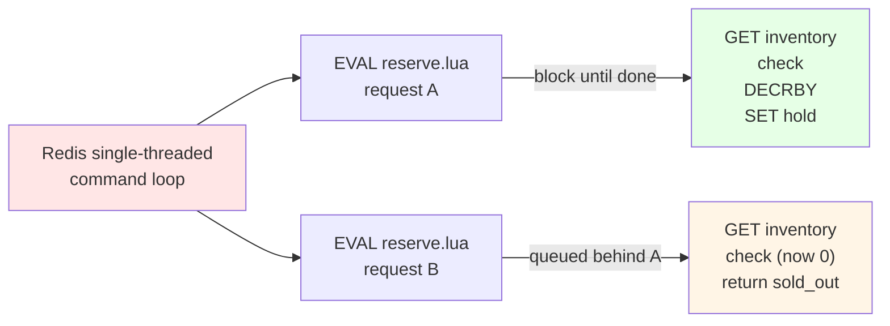

Redis runs all commands on a **single thread**. When you `EVAL` a Lua script, the server blocks on that thread until the script completes — no other command from any client can interleave. The script is a transaction by construction. You don't need `WATCH`/`MULTI`/`EXEC`, you don't need optimistic locking, you don't need to worry about retries.

**This is the single most important property of the system. Atomicity for free.**

### The hold key

A successful reservation creates a hold key (`hold:event:42:user:abc123`) with a **600-second TTL**. The *value* of the key is the seats count (so Phase 7's keyspace watcher can know how many to INCRBY without a DB round-trip — see §9).

The hold key serves **four** roles simultaneously:

1. **Anti-double-booking** — `GET` blocks the same user from a second reservation within 10 minutes
2. **Auto-release on abandonment** — TTL expires → Redis fires keyspace notification → watcher compensates
3. **No cron job for cleanup** — Redis itself enforces the TTL; no background sweeper required for the lock itself
4. **Seats payload for compensation** — the value is the seat count, readable when needed

### Seat limits

The API handler (`internal/api/reserve_handler.go`) enforces `1 ≤ seats_requested ≤ 10`. The DB schema (`migrations/003_add_seats.sql`) mirrors that with a `CHECK (seats >= 1 AND seats <= 10)` constraint.

---

## 5. Phase 3 — Asynchronous Fulfillment

**Goal:** persist confirmed holds to PostgreSQL *after* the user has secured their seat, never during the seat allocation race.

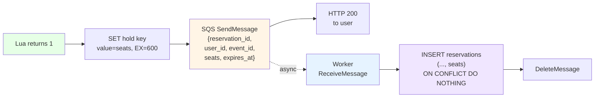

### Publisher interface seam

The handler doesn't import SQS directly — it depends on `api.ReservationPublisher` (`internal/api/publisher.go`), a one-method interface:

```go
type ReservationPublisher interface {
    Publish(ctx context.Context, body []byte) error
}
```

Two implementations:

- **`LogPublisher`** — Phase 5 stub. Writes `[STUB SQS publish] {…}` to the log. Used in dev environments with `SQS_QUEUE_URL` unset.
- **`ReservationAPIPublisher`** — Phase 6. Unmarshals the body (round-trip acts as wire-format validation), then forwards to an inner `SQSPublisher`, which marshals back to JSON for `sqs.SendMessage`. The double marshal is a few microseconds — cheap insurance against silent drift between API and worker.

Wiring happens once in `cmd/api/main.go`'s `buildPublisher()`. **If `SQS_QUEUE_URL == ""`, the function falls back to `LogPublisher`** so the API stays runnable for handler-level work even without SQS configured.

### The worker's idempotency contract

SQS Standard guarantees **at-least-once** delivery. The worker may receive the same message twice (visibility timeout, network blip, crash before delete). That's fine, *as long as the SQL is idempotent*:

```sql
INSERT INTO reservations
    (reservation_id, user_id, event_id, status, expires_at, seats)
VALUES
    ($1, $2, $3, 'PENDING_PAYMENT', $4, $5)
ON CONFLICT (reservation_id) DO NOTHING;
```

The `reservation_id` is a UUID generated by the API when the hold is created. The `UUID PRIMARY KEY` constraint on the table means the second INSERT is a no-op. The worker can `DeleteMessage` either way — `tag.RowsAffected() == 0` is informational, not an error.

**This is why we chose SQS Standard over FIFO.** FIFO has built-in dedup — but it's capped at 300 msg/s, with extra cost. Standard has unlimited throughput; we get exactly-once *processing* by making the *database* the dedup layer. See §10 for the full reasoning.

### At-least-once in practice

`internal/queue/consumer.go::Poll` long-polls in 20-second waits (capped by SQS), receives up to 10 messages per call, dispatches each to a `MessageHandler`:

- `handler` returns `nil` → `DeleteMessage` (success path)
- `handler` returns `err` → leave visible (SQS will redeliver after visibility timeout)
- `Poll`'s `ReceiveMessage` errors → log, 1-second backoff, retry
- `Poll`'s `DeleteMessage` errors after success → log and move on (the DB row already exists; idempotency absorbs the redelivery)

The worker binary runs `Poll` in its main goroutine and watches `signal.NotifyContext(SIGINT, SIGTERM)` for graceful shutdown.

---

## 6. TOCTOU and Why Lua Fixes It

**TOCTOU** = Time-of-Check to Time-of-Use. The bug class that owns most overselling incidents.

### Without Lua: the race

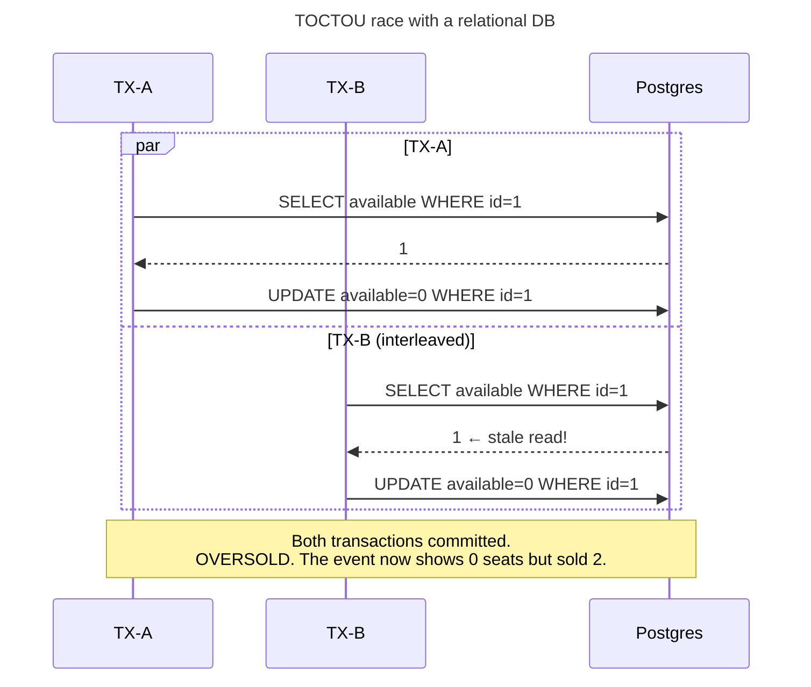

The window between `SELECT` and `UPDATE` is the TOCTOU window. With 1,000 concurrent transactions on the same row, this window opens thousands of times per second. `WHERE available > 0` does not save you — the predicate check happens at `UPDATE` time, but the *read* may have been from a stale snapshot.

You can fix this with `SELECT ... FOR UPDATE` or optimistic concurrency control, but every fix adds latency and complexity.

### With Redis Lua: no window

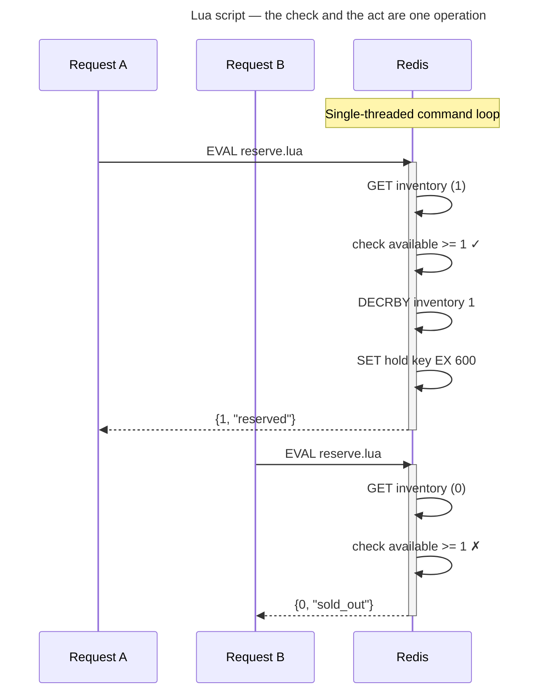

No window. The check (`GET inventory`) and the act (`DECRBY`) happen in the **same atomic step**. By the time Request B's script runs, the inventory is already 0.

---

## 7. The Two-State Model

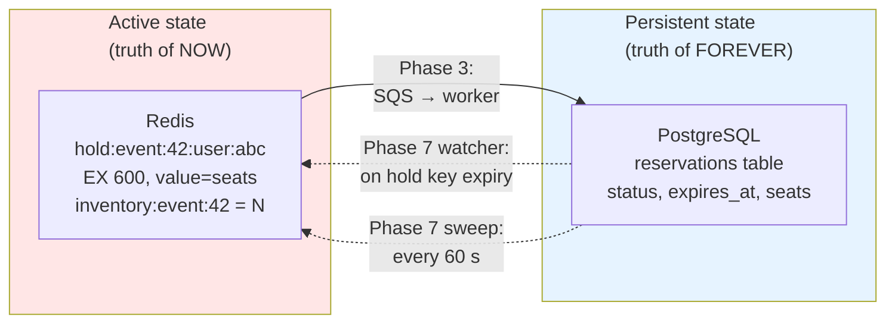


| Concern                                | Lives in | Lifetime           |
| ---------------------------------------- | ---------- | -------------------- |
| "Who has what, right now"              | Redis    | Hold TTL (~10 min) |
| "What was ever sold, with what status" | Postgres | Forever            |
| "Who did what, and can I prove it"     | Postgres | Forever (append-only) |

**The asymmetry is the point.** Redis is the hot, mutable, fast-fading truth of "this user's seat is reserved, expires in 9m 42s." Postgres is the slow, immutable, forever-true ledger of confirmed orders. They serve different access patterns.

You never read from Postgres in the hot path. You never trust Redis for durability.

Phase 7 closes the asymmetry: Postgres's truth can *correct* Redis's truth (sweep). For 99% of cases, Redis drives Postgres (worker INSERT). For the rare lost-notification case, Postgres drives Redis (sweep INCRBY).

---

## 8. Reservation Lifecycle

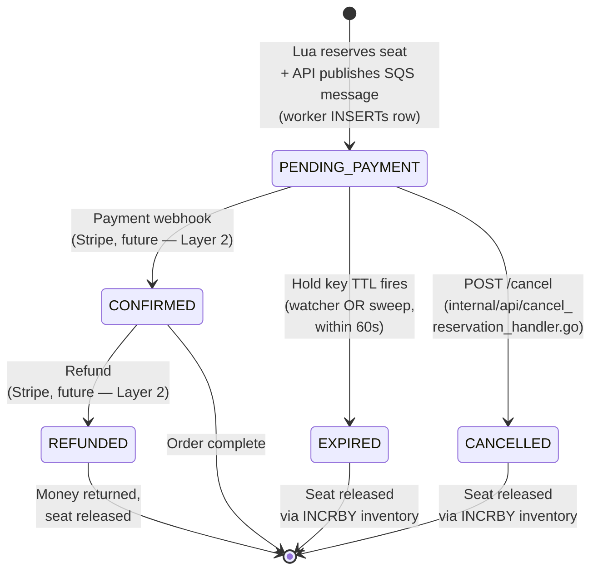

`CANCELLED` and `REFUNDED` are separate on purpose. Both release the seat,
but they are different facts: **nobody paid** vs **the customer paid and
we gave the money back**. Before `migrations/006_refunded_status.sql` a
refund was stored as `CANCELLED` ("refund = cancel in our model"), which
made "we lost the sale" and "we refunded the customer" the same query —
in the DB, in the `?status=` filter, and in any revenue report built on
top of it.

**Five statuses**, of which three are terminal (`EXPIRED`, `CANCELLED`, `REFUNDED`) — plus the implicit "no row ever written" if the worker never gets the SQS message. `PENDING_PAYMENT` is the only transitional state, and `CONFIRMED` has exactly one way out (the refund edge).

The `status` column has a `CHECK` constraint enforcing this set (`migrations/001_init.sql`), and `internal/db/reservations.go` exposes the four values as typed constants (`StatusPendingPayment`, etc.) so a typo at a call site fails to compile.

**The `CHECK` constraint guards the *values*. The `validTransitions` table in `internal/db/transition.go` guards the *edges*.** These are different concerns and both are needed:

- `CHECK (status IN (...))` catches a typo'd status string 100ms after the bad `UPDATE` lands.
- `TransitionStatus` refuses to even *attempt* an impossible transition (`EXPIRED → CONFIRMED`, say) and returns `ErrInvalidTransition` before touching the DB. It encodes the directed graph as data, so "which moves are legal" is a single table rather than a rule scattered across call sites.

Every status change in the system now flows through `TransitionStatus(ctx, pool, id, from, to, audit) (changed bool, err error)` — a compare-and-set `UPDATE ... WHERE reservation_id = $id AND status = $from`. Two callers racing the same row (a user's cancel vs the watcher's expiry sweep, or two parallel cancels) cannot both win: the first gets `(true, nil)`, the second gets `(false, nil)` and re-reads to learn what actually happened. Layer 1's cancel endpoint is the first production consumer; §14 documents the helper in full.

### The audit trail (Layer 2, item 6)

The `reservations` row holds the **current** status. That answers "can this user cancel?" but not "who did what, when, and can I prove it?" — the moment a second transition overwrites the status, the history is gone. A support ticket that says *"I paid and it still says PENDING_PAYMENT"* is unanswerable without a trail.

`reservation_events` (`migrations/005_audit_log.sql`) is that trail, and it is written by the **same transaction** as the status change:

```go
changed, err := db.TransitionStatus(ctx, pool, id,
    db.StatusPendingPayment, db.StatusCancelled,
    db.Audit{Actor: db.UserActor(claims.Subject)})
```

```sql
BEGIN;
  UPDATE reservations SET status = 'CANCELLED'
   WHERE reservation_id = $1 AND status = 'PENDING_PAYMENT';
  INSERT INTO reservation_events (reservation_id, user_id, event_type,
                                  actor_type, actor_id, old_status,
                                  new_status, trace_id, metadata)
  VALUES (...);
COMMIT;
```

Three properties fall out of that shape:

1. **No window where the status changed but the audit row is missing.** If the audit `INSERT` fails, the transaction rolls back and the transition never happened. An audit log that can silently miss rows isn't an audit log.
2. **The actor is mandatory.** `TransitionStatus` rejects an empty actor type with `ErrInvalidAudit` before any SQL runs, so "a transition happened but nobody recorded it" is not a state the code can reach. The signature change was deliberate: a sibling function without an actor would leave exactly that hole.
3. **The event type comes from the EDGE, not the destination status.** `CONFIRMED → CANCELLED` is a `REFUND_INITIATED` — money moved back. `PENDING_PAYMENT → CANCELLED` is a `CANCELLED` — nothing was paid. Same destination status, completely different meaning to whoever reads the log later.

| Path | event_type | actor_type / actor_id |
|---|---|---|
| Worker INSERT | `CREATED` | `user` / the user id |
| Cancel handler | `CANCELLED` | `user` / the JWT subject |
| Expire watcher | `EXPIRED` | `system` / `expiration-watcher` |
| Expire sweep | `EXPIRED` | `system` / `expiration-sweep` |

**Append-only is enforced by the database.** A `BEFORE UPDATE OR DELETE` trigger refuses `DELETE` outright and refuses every `UPDATE` except rewriting `user_id` — the GDPR anonymisation path that Layer 3, item 14 will need. The single escape hatch is a session GUC (`SET LOCAL ticket_deal.audit_purge = 'on'`), used by test fixtures and future retention policies; production code never sets it.

The `trace_id` column is the join key into the observability stack: an ops person holding a trace id can pull up every log line and span for the transition, and an ops person holding an audit row can pull up the trace id that produced it. §13.6 covers the workflow.

---

## 9. Handling Expirations

The lifecycle's `PENDING_PAYMENT → EXPIRED` transition needs two things to happen atomically: the DB row flips to `EXPIRED` and the Redis inventory counter goes back up. Phase 7 ships **two redundant paths** so neither can lose a seat.

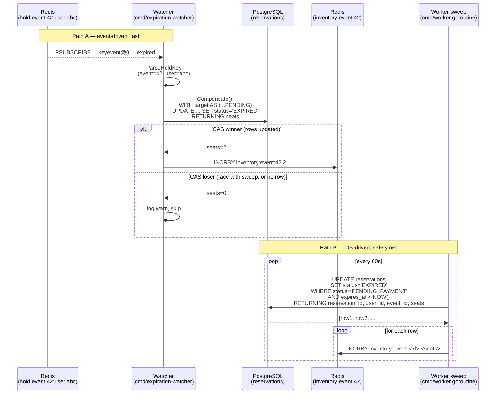

### The shared `Compensate` function

Both paths converge on `internal/expire/compensate.go::Compensate(ctx, pool, rdb, eventID, userID)`:

1. **CAS UPDATE** — single CTE that finds the matching `PENDING_PAYMENT` row for `(user_id, event_id)` and flips it to `EXPIRED`, returning the seat count. The `WHERE status='PENDING_PAYMENT'` filter is the compare-and-set: a second concurrent caller sees 0 rows and skips the INCRBY.
2. **INCRBY inventory** — `INCRBY inventory:event:<id> <seats>` using the row's `seats` value (persisted via migration `003_add_seats.sql`).

This function is the only thing both paths need to share. Putting it in one place means the watcher's event path and the worker's sweep path can never drift.

### Path A: Keyspace watcher (`cmd/expiration-watcher`)

A separate binary that runs `expire.RunWatcher(ctx, rdb, pool)`:

1. `PSUBSCRIBE __keyevent@0__:expired` (DB 0 is the only DB this app uses)
2. On each message, `expire.ParseHoldKey(key)` extracts `(eventID, userID)`. Keys that don't match `hold:event:N:user:U` are filtered out — the expired channel fires for **every** expired key, including ZSET members and bucket state.
3. Valid keys go to `Compensate(ctx, pool, rdb, eventID, userID)`.

**Reconnect strategy:** go-redis PubSub doesn't auto-reconnect on connection drop. `RunWatcher` wraps the subscribe loop with exponential backoff (1 s → 2 → 4 → … → 30 s cap). After a clean subscribe, backoff resets to 1 s.

**Configuration:** `DATABASE_URL` + `REDIS_ADDR` env vars. Defaults to `localhost:6379`.

### Path B: DB-driven sweep (`cmd/worker` goroutine)

The worker runs `expire.RunSweep(ctx, pool, rdb, interval)` as a goroutine alongside the SQS poll loop.

Every `interval` (default 60 s; env `SWEEP_INTERVAL_SECONDS`):

1. `FindAndExpireSweptRows` runs the atomic SQL:
   ```sql
   UPDATE reservations
   SET status = 'EXPIRED', updated_at = NOW()
   WHERE status = 'PENDING_PAYMENT' AND expires_at < NOW()
   RETURNING reservation_id, user_id, event_id, seats;
   ```
2. For each returned row, `INCRBY inventory:event:<id> <seats>`.

**Idempotent** — the `WHERE` clause limits to currently-`PENDING_PAYMENT` rows, so a second tick finds nothing to do.

### Race resolution

If both paths fire for the same `(user, event)`:


| Path                                  | What happens                                                                                                             |
| --------------------------------------- | -------------------------------------------------------------------------------------------------------------------------- |
| Watcher CAS wins, sweep runs after    | Sweep's UPDATE finds 0 rows (status already EXPIRED). Sweep's INCRBY doesn't run.**Total INCRBY: 1.** ✓                 |
| Sweep runs first, watcher fires after | Watcher's CAS finds 0 rows (status already EXPIRED). Watcher's INCRBY doesn't run.**Total INCRBY: 1.** ✓                |
| Both run concurrently                 | Postgres row-locking serializes the UPDATEs. Whichever commits first wins; the other sees 0 rows.**Total INCRBY: 1.** ✓ |

The `WHERE status='PENDING_PAYMENT'` is the entire mechanism. No distributed locks, no coordination protocol.

### Configuration


| Env var                  | Default          | Used by                 |
| -------------------------- | ------------------ | ------------------------- |
| `SWEEP_INTERVAL_SECONDS` | `60`             | Worker sweep tick rate  |
| `REDIS_ADDR`             | `localhost:6379` | Both watcher and worker |

Redis must be started with `--notify-keyspace-events Ex` (`docker-compose.yml` already does this) for any of Path A to fire.

### Caveat: orphan hold keys

The Lua reserve script always publishes SQS *after* creating the hold key. If SQS publish fails between those two steps, the API logs the error but the Redis hold key remains. The Lua committed, but no DB row will ever be written.

When the hold key fires the keyspace notification, `Compensate` finds no DB row → seats=0 → no INCRBY. The seat is **stuck held forever** until a manual operator intervention.

This is the documented edge case from `internal/expire/compensate.go`. To close it would require a Redis-side companion key that survives the TTL (uglier than the current trade-off), or a recovery scan over all `hold:*` keys with no matching DB row (O(inventory) work per restart).

---

## 10. Why SQS Standard (Not FIFO)

The original design used SQS FIFO. We switched. Here's why.

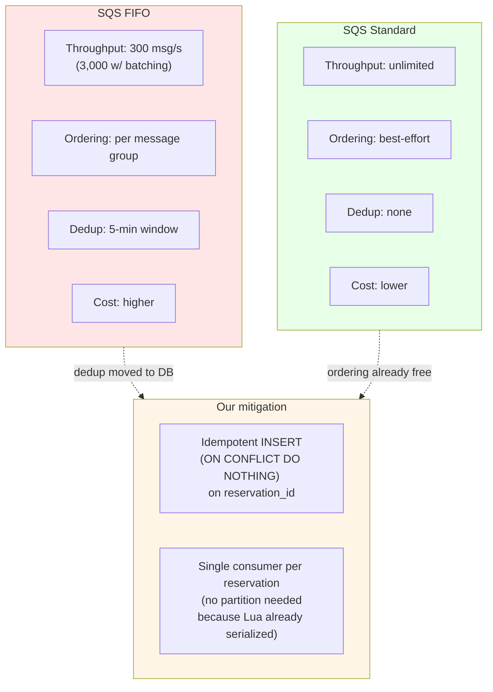


| Concern              | FIFO's answer   | Our answer                                                                          |
| ---------------------- | ----------------- | ------------------------------------------------------------------------------------- |
| Duplicate processing | Built-in dedup  | `ON CONFLICT DO NOTHING` on `reservation_id`                                        |
| Ordering             | Message groups  | Already free — each reservation only flows through the worker's single INSERT path |
| Throughput           | Capped at 300/s | Unlimited                                                                           |

**The math:** Taylor Swift drops 150,000 tickets in 60 seconds = 2,500/sec sustained. FIFO caps at 300/s. We'd need 9 FIFO queues with message-group sharding just to keep up. Standard gives us the headroom for free; we pay for it with idempotent worker writes (which we'd need anyway, because FIFO dedup isn't bulletproof either — it only deduplicates within a 5-minute window).

---

## 11. Failure Modes & Mitigations


| #  | Failure                              | Where it hurts                        | Mitigation                                                                                                                     |
| ---- | -------------------------------------- | --------------------------------------- | -------------------------------------------------------------------------------------------------------------------------------- |
| 1  | Redis goes down                      | Hot path dies                         | Sentinel + replica promotion (sub-second); API returns 503 from health check                                                   |
| 2  | SQS unreachable                      | API can't publish                     | Log + continue (Redis hold is created; orphan hold key — see §9 caveat)                                                      |
| 3  | Worker dies mid-INSERT               | Message redelivered                   | `ON CONFLICT (reservation_id) DO NOTHING` makes the retry safe                                                                 |
| 4  | Postgres unreachable                 | Worker can't persist                  | Message stays in SQS (visibility timeout expires → redelivered); seat is safe in Redis                                        |
| 5  | Lua script crashes mid-execution     | Connection error to caller            | Redis aborts the script; inventory unchanged; caller retries                                                                   |
| 6  | Token bucket under-fills             | Legit users queued unfairly           | Calibrate`WAIT_ROOM_REFILL_RATE`; expose metric on `bucket:event:<id>`                                                         |
| 7  | Hold key expires before payment      | User loses seat                       | Acceptable — 10 min is industry standard; bump via`RESERVE_HOLD_TTL_SECONDS`                                                  |
| 8  | Keyspace notification dropped        | Stale inventory                       | Sweep job catches within 60 s (Path B in §9)                                                                                  |
| 9  | Watcher process down                 | Real-time compensation stops          | Sweep continues to catch missed expirations within 60 s; spawn multiple replicas for high availability                         |
| 10 | Clock skew between Redis and API     | Hold expiry miscalculated             | All TTLs are relative durations from Redis`SET ... EX` — not absolute timestamps                                              |
| 11 | DDoS at the waiting room             | Bucket exhausted forever              | Per-IP token bucket tier (`internal/iplimit/`) rejects before the event bucket is touched                                      |
| 12 | Orphan hold key (no DB row)          | Seat stuck held forever               | Logged by`Compensate`; operator must manually INCR inventory (see §9 caveat)                                                  |
| 13 | INCRBY fails after DB EXPIRED flip   | DB says released, Redis says sold     | `Compensate` logs `WARN`; sweep won't re-process (status is EXPIRED). Operator alerting required.                              |
| 14 | AWS SDK initialized with empty creds | SQS client fails on first SendMessage | `internal/queue/aws.go` injects dummy `local/local` creds when `SQS_ENDPOINT_URL` is non-empty. **Local dev only** — see §12 |
| 15 | Prometheus down | Dashboards stop refreshing; no alerts fire | Hot path is unaffected (Prometheus scrapes are pull-based, timeouts only). Once Prometheus is back, `/metrics` re-scrapes; counters resume from current values (Prometheus computes `rate()` correctly across the gap). |
| 16 | Jaeger / OTLP collector down | Spans buffered in-memory are dropped on shutdown | `tracing.Init` returns a shutdown func; main calls it on `SIGTERM`. If the OTLP endpoint is unreachable, spans are *not* retried — they're dropped (acceptable: next request will be traced). Lower `OTEL_TRACES_SAMPLER_ARG` in prod so a transient gap isn't a big loss. |
| 17 | Promtail / Loki down | Logs still write to `logs/<service>.log`; only Grafana search breaks | Local file buffer is durable. Run `make clear-logs` to inspect offline. Promtail resumes shipping from the last read offset when it restarts (it does NOT replay missed lines from earlier). |
| 18 | `trace_id` made a Loki label | Loki starts 429-ing after ~5k unique values | The label cardinality rule (§13.5): only `service_name` and `detected_level` are labels. `trace_id` is a body field, queried via LogQL `\|= "<id>"`. If you ever see `429` from Loki, suspect a new label. |
| 19 | `make build` not used; raw `go build ./cmd/...` | Stray binaries (`./api`, `./worker`, …) in repo root | Use `make build` (or `go build -o bin/<name> ./cmd/<name>`). The Makefile rule enforces `-o`; raw `go build` doesn't. See AGENTS.md §Important Conventions #8. |
| 20 | Idempotency cache entry corrupt (schema drift / manual tampering) | Retry can't replay; gets a fresh reserve | `Lookup` returns `ErrIdempotencyCacheCorrupt`; the handler logs `WARN` and treats it as a miss. The bad entry self-heals via its 24h TTL. Never surfaces a 5xx to the user for a cache problem. |
| 21 | Idempotency cache `Store` fails after a successful reserve | The reservation succeeded but future retries can't replay — they'll mint a *second* reservation | Non-fatal by design: `slog.WarnContext` only, still `200` to the client. The user has their seat. Worst case is at-most-once instead of exactly-once for a retry, which is strictly better than the pre-Layer-1 behaviour (every retry double-booked). |
| 22 | In-flight idempotency lock not released (process killed mid-request) | Future retries see `409 in_flight` for up to 5 s | The SETNX lock carries a 5 s TTL, so it self-heals without operator action. Every *terminal* code path also issues an explicit `DEL` (`releaseLockIfHeld`), so the 5 s window only applies to a hard crash. |
| 23 | Cancel: Redis INCRBY fails after the DB transition succeeded | DB says CANCELLED, Redis still counts the seat as sold — "phantom seat" | `slog.WarnContext` + still `200` to the client. Deliberate: DB is the system-of-record for *intent*; returning 5xx would make the client retry into `409 already_cancelled` and confuse the user. Operator reconciles inventory via a manual INCRBY (same runbook as row 13). The divergence window is the Redis outage duration. |
| 24 | Cancel: hold-key `DEL` fails | User is briefly `409 already_holding` on their next `/reserve` | Best-effort by design — the key has a TTL, so it self-heals. Never a 5xx; the user's cancellation already succeeded. |
| 25 | Postgres unreachable, API alive | `/readyz` returns `503`; the Layer 1 read endpoints (`GET /api/reservations/:id`, `/me/reservations`, `POST /cancel`) all fail | `/readyz` surfaces it so a load balancer stops routing traffic here. `/reserve` itself is **unaffected** — the hot path is Redis-only by design (the asymmetry is the point; see §7). A failed readiness check pulls the pod from rotation without triggering a restart loop, which is why `/readyz` is separate from `/healthz`. |

---

## 12. Known Development Sharp Edges

*Gotchas that cost debugging time during Phase 0–7. Save future-us the same headache.*

### 1. AWS SDK requires non-empty credentials even with a custom endpoint

The `aws-sdk-go-v2` SQS client fails on first send with `NoCredentialProviders` if both `AWS_ACCESS_KEY_ID` and `AWS_SECRET_ACCESS_KEY` are empty — **even when** you've pointed it at `http://localhost:9324` via `SQS_ENDPOINT_URL`. ElasticMQ does not authenticate, but the SDK still requires credentials to construct the signer.

**The fix** — `internal/queue/aws.go::NewSQSClient` detects `EndpointURL != ""` and sets dummy `local/local` creds if unset:

```go
if cfg.EndpointURL != "" {
    if os.Getenv("AWS_ACCESS_KEY_ID") == "" {
        _ = os.Setenv("AWS_ACCESS_KEY_ID", "local")
    }
    if os.Getenv("AWS_SECRET_ACCESS_KEY") == "" {
        _ = os.Setenv("AWS_SECRET_ACCESS_KEY", "local")
    }
}
```

In production, `EndpointURL` is empty so this branch doesn't run — the SDK uses the standard credential chain (IAM role, env vars, `~/.aws/credentials`).

### 2. ElasticMQ healthcheck: use `curl`, not `wget` or `/dev/tcp`

The image's shell is **alpine `sh` (busybox)**, and a bare `GET /` against ElasticMQ returns **HTTP 400**. That breaks two seemingly-obvious healthchecks:


| Approach                                  | Why it fails                                                                           |
| ------------------------------------------- | ---------------------------------------------------------------------------------------- |
| `wget -q --spider http://localhost:9324/` | Exits with code 8 on the 400 response → false negative                                |
| `exec 3<>/dev/tcp/127.0.0.1/9324`         | `/dev/tcp` is **bash-only**; alpine `sh` says *"cannot create: Directory nonexistent"* |

**The fix** — `curl` exits 0 on any HTTP response, so we succeed whenever TCP is up:

```yaml
test: ["CMD-SHELL", "curl -s -o /dev/null http://127.0.0.1:9324/"]
```

Use this shape for any future docker-compose SQS-compatible service.

### 3. Adding the `seats` column to an existing `reservations` table

When Phase 7 added `seats` to track how many seats a hold represents (so the watcher can INCRBY the right number on expiry), the migration had to preserve all existing rows.

**Wrong:** `ADD COLUMN seats INTEGER NOT NULL` — fails because existing rows have no default.

**Right:** `ADD COLUMN seats INTEGER NOT NULL DEFAULT 1 CHECK (seats >= 1 AND seats <= 10)` — the `DEFAULT 1` backfills existing rows, and the `CHECK` mirrors the API handler's `1 ≤ seats_requested ≤ 10` validation. See `migrations/003_add_seats.sql`.

### 4. Lua's `TIME` breaks determinism in tests

All four Lua scripts (`reserve.lua`, `token_bucket.lua`, `ip_bucket.lua`) take `now_ms` as an `ARGV` rather than calling `redis.call('TIME')` inside the script. **Why:** tests need to inject specific times to verify "bucket refilled by X over Y seconds" deterministically. If a script called `TIME`, every test would race the wall clock and produce flaky assertions.

The convention is enforced by the comment in each script:

```lua
-- ARGV[3] = now_ms (current time in ms; passed by caller for testability — never use TIME inside Lua)
```

### 5. The redis client `PoolSize = 100` is a hot-path trade-off

`internal/redis/client.go::NewClient` sets `PoolSize: 100`. The justification is in the comment: 1,000 concurrent Lua calls each grab a connection, run EVAL in ~50 µs, and return — so 100 conns × ~20k ops/sec per conn = 2M ops/sec ceiling. Below the 1000-concurrent test ceiling, no connection contention.

If you ever bump the per-process connection count above the Redis server's `maxclients` setting (default 10,000), the client will block waiting for a free connection. Watch for `i/o timeout` errors in `cmd/api` logs as the warning sign.

---

## 13. The Observability Pillar

> **Why this section exists:** Phases 10–13 added a complete 4-pillar observability stack on top of the core system. The hot path is unchanged — every observability wire below is **a side-channel** that samples/buffers locally and ships to a side system. A failure in any observability sink does not affect a single user request.

### 13.1 Why observability, why now

The core system (§§1–10) is correct on paper but **blind at runtime**. The burst test can show "100 reserved, 900 sold_out" — but a real production system needs to answer:

| Question | Pillar that answers it |
|---|---|
| "How many reservations/sec right now? Is p(99) climbing?" | **Metrics** |
| "Why was *this one* request slow? Where did the time go?" | **Traces** |
| "What code path did this trace hit? What was the error message?" | **Logs** |
| "Is this anomaly real, or a transient blip?" | **All three**, joined by `trace_id` |

A single pillar gives one of these answers. **All four, joined by `trace_id`, give you the others for free** (§13.6). This is the design.

### 13.2 The four pillars at a glance

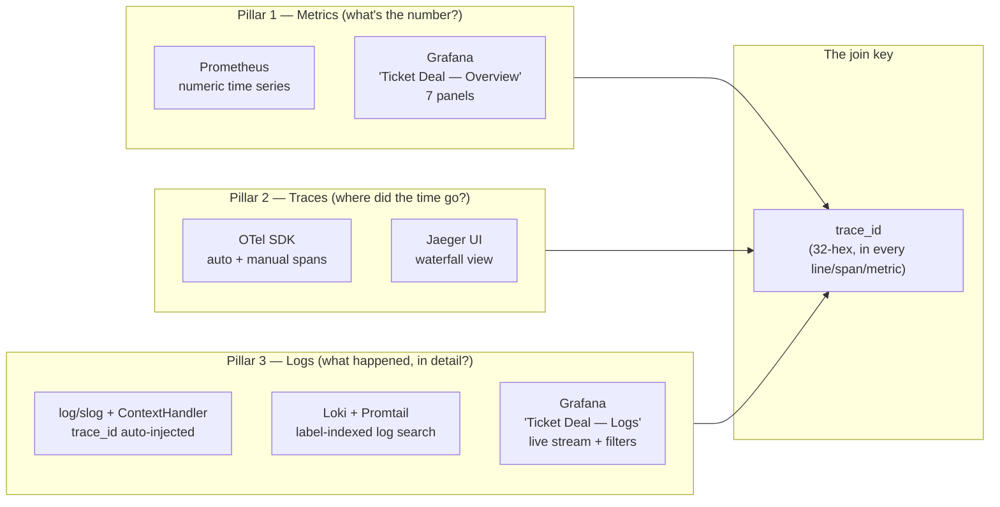

| Pillar | Sink | Format | Cardinality | Sample question |
|---|---|---|---|---|
| **Metrics** | Prometheus → Grafana | numeric time series | low (label is `service`, `path`, `status`) | "What's the p(99) of `/reserve` over the last 5m?" |
| **Traces** | Jaeger UI | tree of spans | medium (per-request `trace_id`, `span_id`) | "Show me the slowest 5 traces in the last 10m." |
| **Logs** | Loki → Grafana | text lines with key=value attrs | low (label is `service_name`, `detected_level`) | "Find every log line for trace `fac1f09d…`." |
| **(Join)** | `trace_id` | 32-hex W3C TraceContext | one per request | "Show me everything that happened in this one request." |

### 13.3 Metrics: Prometheus + Grafana

**What it answers:** "Is the system healthy? Is something degrading? Did we just oversell?"

**The wire.** Every Go service exposes `/metrics` on its own port (Prometheus text format):

| Service | Endpoint |
|---|---|
| API | `http://localhost:8080/metrics` (mounted on the chi router) |
| Worker | `http://localhost:8081/metrics` (dedicated tiny HTTP server, env `METRICS_ADDR`) |
| Expiration-watcher | `http://localhost:8083/metrics` (env `METRICS_ADDR`) |

All 4 Go services run in Docker alongside Prometheus; they're on the same user-defined Docker network, so Prometheus scrapes them by **service name** (`api:8080`, `worker:8081`, `expiration-watcher:8083`). See `monitoring/prometheus.yml` for the scrape config.

**The metric catalog** (`internal/metrics/metrics.go`): every metric name, label set, and histogram bucket is defined in **one file** so all services use identical semantics. Highlights:

| Metric | Type | Labels | Use |
|---|---|---|---|
| `reservations_held_total` | counter | — | Throughput: reservations accepted |
| `reservations_completed_total` | counter | — | Throughput: SQS publish succeeded |
| `reservations_oversold_total` | counter | — | **The alarm metric. MUST stay 0.** |
| `reservations_sold_out_total` | counter | — | Load shedding: 409s returned |
| `reservations_already_holding_total` | counter | — | Idempotency: same user retried |
| `redis_seats_available` | gauge | `event_id` | Live inventory (periodically sampled) |
| `waiting_room_queue_length` | gauge | `event_id` | Live queue depth |
| `idempotency_replays_total` | counter | — | Retries served from the 24h cache instead of a fresh reserve |
| `idempotency_body_mismatch_total` | counter | — | Same `Idempotency-Key`, different body → `409`. **Rising trend = a client bug** (they're retrying with a changed request without rotating the key) |
| `http_requests_total` | counter | `service, path, method, status` | Per-route, per-status traffic |
| `http_request_duration_seconds` | histogram | `service, path` | Latency p50/p90/p99 |

The **defining invariant** of this project: `reservations_oversold_total` is always 0. If it goes positive, *something fundamental broke* and a human needs to look. The Grafana "Ticket Deal — Overview" dashboard has a single-stat panel pinned to this metric in the top-left so it's the first thing the eye lands on.

**The dashboard** (`monitoring/grafana/dashboards/ticket-deal-overview.json`): 7 panels, dark "control room" aesthetic. Top row: oversold counter (red, always 0), reservations held/sold_out rate, HTTP error rate. Middle: p50/p90/p99 latency by route (line graph over 5m window), live inventory gauge per event. Bottom: queue depth per event, status code split (200/409/other as stacked area).

Auto-provisioned on Grafana startup via `monitoring/grafana/provisioning/dashboards/dashboards.yml` — no manual `import JSON` step.

### 13.4 Traces: OpenTelemetry + Jaeger

**What it answers:** "Why was *this one* request slow? Where did the time go? Which call took 200ms?"

**The wire.** Every Go service calls `tracing.Init(ctx, "api"|"worker"|"expiration-watcher")` at startup. This sets up:

1. The **global `TracerProvider`** with a W3C TraceContext propagator.
2. An **OTLP/gRPC exporter** pointing at `http://localhost:4317` (Jaeger's all-in-one collector port). Env override: `OTEL_EXPORTER_OTLP_ENDPOINT`.
3. A **sampler** controlled by `OTEL_TRACES_SAMPLER_ARG` (default `1.0` = trace everything; lower in prod to sample).
4. A shutdown func that flushes pending spans — invoked during graceful shutdown so the last 5s of spans aren't lost.

**Auto-instrumentation** (no per-request code needed):

| Library | What it traces |
|---|---|
| `otelhttp.NewHandler(router, "api")` | Every HTTP request becomes a parent span (api only) |
| `redisotel.InstrumentTracing(rdb)` | Every Redis call (GET, SET, EVALSHA) becomes a child span |
| `otelpgx.NewTracer()` on `pgxpool.ConnConfig` | Every pgx query becomes a child span (worker + watcher) |

**Manual spans** in the reserve flow (`internal/api/reserve_handler.go`):

| Span | Kind | Attributes | Parent |
|---|---|---|---|
| `reserve.handle` | internal | `event_id`, `user_id`, `seats_requested`, `reservation.id` | HTTP root |
| `redis.acquire-hold` | client | `redis.op=EVALSHA`, `seats` | `reserve.handle` |
| `sqs.publish` | producer | `messaging.system=aws_sqs`, `messaging.destination=reservations` | `reserve.handle` |

**The hard part: SQS context propagation.** SQS has no native trace header propagation. The publisher (`internal/queue/trace.go`) writes the W3C `traceparent` header into **two** places:

1. `MessageAttributes` (AWS-standard) — preserved by real AWS SQS.
2. The JSON body as `_traceparent` — **required** for ElasticMQ, which strips `MessageAttributes` in local dev.

The consumer tries `MessageAttributes` first, falls back to the body. Both paths are tested in `internal/queue/trace_test.go`. End result: the worker's `worker.handleMessage` span is a **child of** the API's `sqs.publish` span, even though they run in different processes with a queue between them.

**The waterfall** for a single `POST /api/tickets/reserve` (typical happy path):

```
POST /api/tickets/reserve           [35ms]   ← HTTP root
└─ reserve.handle (api)             [35ms]   ← manual parent
   ├─ redis.acquire-hold (api)      [3ms]    ← Lua EVAL
   │  └─ EVALSHA (api)              [1ms]    ← auto-instrumented
   └─ sqs.publish (api)             [22ms]   ← SQS SendMessage
      └─ (queue latency)            [~ms]    ← invisible to trace
         └─ worker.handleMessage    [1ms]    ← consumer span, parent jumps
            ├─ pool.acquire (wkr)   [0ms]    ← auto-instrumented
            └─ INSERT (wkr)         [1ms]    ← pgx auto-instrumented
```

**The Jaeger UI** (http://localhost:16686) lets you filter by service (`api`, `worker`, `expiration-watcher`) or by `trace_id`. The "min duration" filter is the go-to for "show me the slow ones."

### 13.5 Logs: `log/slog` + Loki + Promtail

**What it answers:** "What code path did this trace hit? What was the exact error message? Who got rate-limited?"

**The wire.** Every long-running service (api, worker, watcher, dashboard-server) calls `logging.Init(logging.Config{...})` **first thing in `main()`** — before any other code, so even `tracing.Init` failures are captured in the right format. The config takes level, format (text/json), service name, and version; env vars are `LOG_LEVEL`, `LOG_FORMAT`, `SERVICE_VERSION`.

The init wraps `slog`'s default `Handler` in a **`ContextHandler`** (`internal/logging/context_handler.go`, ~30 LOC) that pulls the active OTel span off the request `ctx` and auto-injects `trace_id` + `span_id` into every log line. The convention is: **if you have a `ctx`, use `slog.InfoContext(ctx, ...)`; if not, use `slog.Info(...)`** (rare). The ContextHandler is a no-op when there's no active span (e.g. one-shot CLIs).

**The chi access log** (`internal/apiutil/middleware/slog_logger.go`) replaces `chi/middleware.Logger`. It runs *after* the OTel HTTP middleware, so the access log line carries the request's `trace_id` automatically. One swap, every request gets correlated.

**The shipping pipeline:**

```
Go service ──slog (stdout)──> nohup catches it ──> logs/<service>.log
                                                       │
                                                       ▼  (host bind mount)
                                                  /var/log/ticket-deal  ◀── Promtail (in container)
                                                       │
                                                       ▼  (parse + label)
                                                  Loki  ──>  Grafana "Ticket Deal — Logs"
```

Promtail (`monitoring/promtail/promtail-config.yml`) tails each `logs/<service>.log` file and ships to Loki (`monitoring/loki/loki-config.yml`, port 3100). Loki stores the lines in a filesystem backend (single-replica, 7-day retention) and serves them via its HTTP API.

**The label cardinality rule (CRITICAL).** Loki indexes only a small set of *labels* per log line. Every unique (label-set → stream) combination counts against Loki's **active-stream cap (~5,000 in default config)**. If you make `trace_id` a label, you blow past that cap in 5,000 requests. **Rule:** only **low-cardinality** dimensions become labels (`service_name`, `detected_level`); high-cardinality fields (`trace_id`, `user_id`, `reservation_id`) stay in the log **body** and are queried via LogQL line-filter `|= "..."` (text contains), not label match.

**The Promtail 3.x gotchas** (all earned in production debugging — see `monitoring/promtail/promtail-config.yml` for inline comments):

1. `__path__` is consumed during file discovery, so `relabel_configs` can't see the expanded path. **Workaround:** one `scrape_configs` block per file, each with an explicit `service_name` label, not a glob + regex.
2. `labels: level:` (empty value) silently sets the label to `""`, which Loki drops. The `{{.lvl}}` template syntax for capture groups is finicky. **Workaround:** drop the custom pipeline entirely; Promtail's built-in `detected_level` (lowercase) does the same job.

**The Loki 3.x query gotcha.** LogQL rejects queries where *every* matcher is empty-compatible. So `{service_name=~".*"} | detected_level=~".*"` is rejected with:
```
queries require at least one regexp or equality matcher that does not have
an empty-compatible value. For instance, app=~".*" does not meet this
requirement, but app=~".+" will
```
The "All" default for every variable on the logs dashboard is `.+` (positive match, requires ≥1 char), not `.*`.

**The Grafana "Ticket Deal — Logs" dashboard** (`monitoring/grafana/dashboards/ticket-deal-logs.json`, uid `ticket-deal-logs`): 4 panels + 4 variables.

- **Variables:** `service` (multi-select from `label_values(service_name)`), `level` (All / INFO+ / WARN+ / ERROR — uses `detected_level` regex), `trace_id` (text box), `search` (text box).
- **Panel 1 (text):** "How to use this dashboard" hint.
- **Panel 2 (timeseries):** Log volume by service, last 1m rate.
- **Panel 3 (timeseries):** Log mix by detected level, last 1m rate.
- **Panel 4 (logs):** Live log stream with all four variable filters applied.

### 13.6 The killer combo: `trace_id` is the join key

The whole reason for picking W3C TraceContext + auto-injecting `trace_id` into every log line is this workflow:

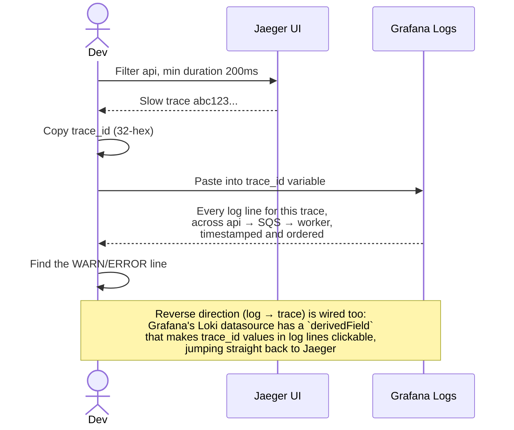

In practice, the workflow is:

1. **Spot a slow trace in Jaeger** → "This POST took 380ms, the SQS publish alone took 250ms." Grab the `trace_id` from the URL or the span.
2. **Open Grafana → "Ticket Deal — Logs"** → paste the `trace_id` into the `trace_id` variable. See every log line for that request, across services, in time order. The 250ms publish usually has a `WARN` line right next to it explaining why.
3. **Click the `trace_id` value in a log line** → Grafana jumps back to Jaeger showing the full waterfall. (Wired via `derivedField` in `monitoring/grafana/provisioning/datasources/datasource.yml`.)

**The reverse** (log → trace) is the one that gets used most in practice: you're reading logs, see a `WARN: publish failed`, click the `trace_id`, Jaeger opens with the full request context. You can do this in two clicks from the Grafana logs panel.

### 13.7 Why this design (the decisions behind the choices)

| Decision | Why |
|---|---|
| **3-pillar Prometheus+Jaeger+Loki, not a SaaS like Datadog/New Relic** | Self-hostable, no per-GB fees, every layer is replaceable. The 4th pillar (Grafana) ties it together with a single UI. |
| **OpenTelemetry SDK, not a vendor-specific tracer** | Vendor-neutral. The OTLP exporter sends to Jaeger today, to Tempo or Honeycomb tomorrow, with zero code change. |
| **`log/slog` from stdlib, not zap/zerolog/logrus** | `slog` is in stdlib since Go 1.21; no dep churn, no `init()` magic, structured attrs by default. The custom `ContextHandler` is 30 lines and replaces every other logger's equivalent. |
| **W3C TraceContext, not B3 or Jaeger's own** | The standard. Every observability vendor supports it. Cross-service propagation "just works" because it's the same header everywhere. |
| **Filesystem Loki backend, not S3** | Local dev doesn't need S3. The storage layer is pluggable; same `loki-config.yml` works with `aws: { s3: … }` block in prod. |
| **Label cardinality cap, not "index everything"** | Loki's stream cap is a hard limit (~5k by default). Knowing which dimensions are low-cardinality is the difference between a queryable system and a 429-spamming outage. |
| **OTLP/gRPC, not OTLP/HTTP** | Lower overhead, multiplexing, bidi streaming. Jaeger all-in-one accepts both, so `OTEL_EXPORTER_OTLP_ENDPOINT=http://localhost:4317` works out of the box. |
| **Text logs to stdout, not journald/syslog** | One format, one tool (`tail`, `grep`, `jq`), no surprise container-log rotation. Promtail tails the file directly. |

## 14. File-by-File Reference

> **Reading guide:** each entry lists purpose, key types/functions, and what depends on it. When you forget how something fits, scan the matching entry. Files are grouped by directory.

### Top level

#### `README.md`

Project landing page. Current Status table (Phases 0–9), Tech Stack table, Project Layout tree, Quick Start (docker-compose + migrations + env), and the "Next:" pointer. Updated in lockstep with each phase's docs commit.

#### `.env.example`

Template for `.env` (gitignored). Every env var consumed by the project lives here: API_PORT, JWT_SECRET, REDIS_ADDR, IP/WAIT_ROOM limits, RESERVE_HOLD_TTL, DATABASE_URL (or the `POSTGRES_*` family, which `config.Load()` composes into a DSN), SQS_* (ElasticMQ URL + queue name + URL), SWEEP_INTERVAL_SECONDS, AWS_* (region + dummy creds for ElasticMQ). Comments explain each value.

Host-mode `.env` — used by `make api-bg` / `make worker-bg` and by the k6 wrappers. Values point at `localhost`.

#### `.env.docker.example`

The **container-mode** twin of `.env.example`, committed as a template. Same variable set, but hostnames resolve on the Docker network: `REDIS_ADDR=redis:6379`, `DATABASE_URL=postgres://…@postgres:5432/…`, `SQS_ENDPOINT_URL=http://elasticmq:9324`, `OTEL_EXPORTER_OTLP_ENDPOINT=http://jaeger:4317`. Because these embed DNS names, they can't be shared with host mode — hence a separate file rather than an override layer.

`scripts/setup-docker-env.sh` generates `.env.docker` from it (gitignored, idempotent, re-runnable). On first run it copies the host `.env`'s `JWT_SECRET` across if one exists, so the JWTs minted by `bin/mintjwt` on the host still verify inside the container — that's what lets you smoke-test a `POST /reserve` from curl against the containerised API.

#### `.gitignore`

Standard Go ignores (`*.test`, `coverage.out`), editor cruft (`.vscode/`, `.idea/`, `.DS_Store`), vendoring (`/vendor/`), secrets (`.env`, `.env.*` — which covers both `.env` and `.env.docker`), runtime logs, k8 `loadtest/results/` and `summary.html`. Doesn't currently ignore `scripts/*.go` — that's the untracked smoke-test artifact.

#### `Dockerfile`

One shared multi-stage Dockerfile, parameterised by a `SERVICE` build arg. Building any of the 4 Go services is `docker build --build-arg SERVICE=api .` (same for `worker`, `expiration-watcher`, `dashboard-server`).

- **Stage 1** — `golang:1.27-alpine`, compiles `cmd/$SERVICE` with CGO disabled (static binary, no libc dependency at runtime).
- **Stage 2** — `gcr.io/distroless/static-debian12:nonroot`. Binary copied to the constant path `/app/server` for every service, so the compose `command:` is identical across all four (`["/app/server"]`) regardless of which service was built.

The constant-path trick is what lets one Dockerfile serve four services without per-service paths leaking into compose. The `SERVICE` arg only ever affects the *build*; at runtime the container just runs `/app/server`.

`.dockerignore` keeps the build context lean (excludes `.git/`, `logs/`, `bin/`, `loadtest/results/`) so a rebuild doesn't invalidate the layer cache on every log line.

#### `docker-compose.yml`

**Twelve services** — 8 infrastructure + 4 Go services. All with healthchecks wired into `depends_on: condition: service_healthy` (where applicable):

| Service | Image | Port(s) | Purpose |
|---|---|---|---|
| `redis` | `redis:7-alpine` | 6379 | Hot path: token buckets, hold keys, Lua |
| `postgres` | `postgres:16-alpine` | 5432 | Cold path: source of truth |
| `elasticmq` | `softwaremill/elasticmq:latest` | 9324 | Async: SQS-compatible queue |
| `prometheus` | `prom/prometheus:v2.55.0` | 9090 | Metrics scrape |
| `grafana` | `grafana/grafana:11.3.0` | 3000 | Dashboards (admin/admin123) |
| `jaeger` | `jaegertracing/all-in-one:1.76.0` | 16686, 4317-4318, 14268 | OTLP collector + UI |
| `loki` | `grafana/loki:3.3.0` | 3100 | Log storage (HTTP API, no UI) |
| `promtail` | `grafana/promtail:3.3.0` | 9080 | Log shipper (binds host `./logs`) |
| `api` | built from `Dockerfile` (`SERVICE=api`) | 8080 | HTTP API (`/healthz`, `/readyz`, `/metrics`, `/api/tickets/*`, `/api/reservations/*`, `/api/me/reservations`) |
| `worker` | built from `Dockerfile` (`SERVICE=worker`) | 8081 | SQS consumer + 60s expiry sweep |
| `expiration-watcher` | built from `Dockerfile` (`SERVICE=expiration-watcher`) | 8083 | Redis keyspace subscriber |
| `dashboard-server` | built from `Dockerfile` (`SERVICE=dashboard-server`) | 8082 | k6 live-dashboard proxy |

Volumes: `redis-data`, `postgres-data`, `prometheus-data`, `grafana-data`, `jaeger-data`, `loki-data`. Configs are bind-mounted from `monitoring/{prometheus,grafana,jaeger,loki,promtail}/`.

Notes:
- **All 4 Go services run in Docker.** This was the whole point of the dockerization milestone — `host.docker.internal` scrape targets are gone, Prometheus now scrapes by service name (`api:8080`, `worker:8081`, …) on the same Docker network. Host mode still works (`make api-bg`, `make worker-bg`) for fast `go run`-style iteration, and reads the same `.env`, so a JWT minted by host-side `bin/mintjwt` verifies in either place.
- `./logs` is bind-mounted **read-write** into each Go service (so each writes to `logs/<service>.log` via the `LOG_FILE` env var) and **read-only** into promtail. One path, two mounts, one log file per service.
- `redis` is started with `--notify-keyspace-events Ex` (Phase 7) + `--appendonly yes` (durability) + `--maxmemory 512mb` + `--maxmemory-policy allkeys-lru`.
- `postgres` env from `POSTGRES_USER/PASSWORD/DB` (default `tickets/tickets/tickets`).
- `elasticmq` mounts `./docker/elasticmq.conf` so the `reservations` queue is auto-created with 30 s visibility + 20 s long-poll.
- `jaeger` accepts OTLP/gRPC on `:4317` and OTLP/HTTP on `:4318`.
- `promtail` uses `restart: always` rather than `unless-stopped` — a compose v5.5.1 / engine 29.8.2 quirk that rejects the latter policy for this service specifically. Left with a `TODO(investigate)` comment to re-test once upstream sorts it out.

#### `docker/elasticmq.conf`

Pre-creates the `reservations` queue on boot — saves the dev the `aws --endpoint-url=... sqs create-queue` step. Standard type (no max-receive-count → no DLQ).

---

### `monitoring/` — observability configs

All observability side-channel configs. Bind-mounted into the corresponding Docker service by `docker-compose.yml`. Self-contained: nothing in this directory is imported by the Go code; they're pure config for Prometheus / Grafana / Jaeger / Loki / Promtail.

#### `monitoring/prometheus.yml`

Scrape config. Three targets (`api:8080`, `worker:8081`, `expiration-watcher:8083`) — all resolved as Docker **service names** on the shared user-defined network, which is what lets Prometheus reach them now that the Go services are containerised. 10s scrape interval. Used as Prometheus's `--config.file` flag.

#### `monitoring/grafana/provisioning/`

Auto-provisioned datasource + dashboard configs so Grafana is "ready" the moment it starts (no manual `Add datasource` or `Import JSON` step).

- **`datasources/datasource.yml`** — Prometheus + Loki datasources. The Loki datasource has a `derivedField` that extracts `trace_id` (32-hex) from log lines and turns it into a clickable link to Jaeger (`http://localhost:16686/trace/${...}`). This is what makes the log → trace navigation "just work."
- **`dashboards/dashboards.yml`** — provider config that points Grafana at `monitoring/grafana/dashboards/` and auto-loads every JSON file it finds there on startup.

#### `monitoring/grafana/dashboards/ticket-deal-overview.json`

**"Ticket Deal — Overview"** dashboard (uid `ticket-deal-overview`). 7 panels, dark "control room" aesthetic, Prometheus-backed. The headline panel is `reservations_oversold_total` (top-left, single-stat, must always read 0). Other panels: held/completed rate, sold-out rate, HTTP error rate, p50/p90/p99 latency by route, live inventory gauge per event, queue depth per event, status code split.

Designed during the observability milestone (shipped on `feature/observability`) with a dark "control room" aesthetic: 7 panels, `reservations_oversold_total` pinned top-left in red (the invariant must be the first thing the eye lands on), per-route latency line-graphed over a 5m window rather than stat'd, status codes as a stacked area.

#### `monitoring/grafana/dashboards/ticket-deal-logs.json`

**"Ticket Deal — Logs"** dashboard (uid `ticket-deal-logs`). 4 panels, Loki-backed. Variables: `service` (multi-select from `label_values(service_name)`), `level` (All/INFO+/WARN+/ERROR, uses Promtail's `detected_level` regex with `.+` for "All" — see §13.5), `trace_id` (text box), `search` (text box). Panel 1 is a "how to use" hint. Panel 2 is log volume by service (1m rate). Panel 3 is log mix by level (1m rate). Panel 4 is the live log stream with all four variable filters applied. The "killer combo" workflow (§13.6) starts here.

#### `monitoring/loki/loki-config.yml`

Loki 3.3.0 single-replica config. Filesystem backend (no S3 in dev — swap to `aws: { s3: … }` for prod). `auth_enabled: false` (local dev). `ingestion_rate_mb: 32` and `per_stream_rate_limit: 16MB` (both bumped from defaults to absorb burst load). 7-day retention via `compactor`. Schema v13 with tsdb. Bound to `:3100`; no UI (use Grafana as the frontend).

#### `monitoring/promtail/promtail-config.yml`

Promtail 3.3.0 config. **One `scrape_configs` block per log file** (api, worker, expiration-watcher, dashboard-server) — see §13.5 for the Promtail 3.x `__path__` gotcha. Each block has an explicit `service_name` label (NOT a glob + regex; that doesn't work in Promtail 3.x because `__path__` is consumed during file discovery). `pipeline_stages: []` — no custom level extraction; Promtail's built-in `detected_level` (lowercase) does the job. Bind-mounts the host's `./logs` to `/var/log/ticket-deal:ro` in `docker-compose.yml`.

#### `monitoring/jaeger/`

The Jaeger all-in-one container reads no config file by default — the `OTEL_EXPORTER_OTLP_ENDPOINT=http://localhost:4317` in the Go services is the entire contract. (If we ever need a config, this is where it would go.)

#### `go.mod` / `go.sum`

Module `github.com/emmitt-k/ticket-deal`, Go 1.27.1. Direct deps:

- `github.com/go-chi/chi/v5` — router (Phase 3)
- `github.com/golang-jwt/jwt/v5` — HS256 only (Phase 3)
- `github.com/google/uuid` — reservation_id generation (Phase 5)
- `github.com/jackc/pgx/v5` + `pgxpool` — Postgres (Phase 6)
- `github.com/aws/aws-sdk-go-v2` + `awsconfig` + `service/sqs` — SQS (Phase 6)
- `github.com/redis/go-redis/v9` — Redis client + Lua EVAL (Phase 2, 4, 7)
- `github.com/redis/go-redis/extra/redisotel/v9` — Redis OTel auto-instrumentation (Phase 11)
- `github.com/joho/godotenv` — `.env` overlay (Phase 3)
- `github.com/stretchr/testify` — test assertions everywhere
- `github.com/prometheus/client_golang` — Prometheus metrics (Phase 10)
- `go.opentelemetry.io/otel` + `sdk` + `exporters/otlp/otlptrace/otlptracegrpc` + `instrumentation/net/http/otelhttp` + `instrumentation/github.com/redis` + `instrumentation/github.com/jackc/pgx` — OTel SDK + auto-instrumentation (Phase 11)
- `go.opentelemetry.io/contrib/instrumentation/runtime` — Go runtime metrics (goroutines, GC, heap) (Phase 10)

---

### `cmd/` — six binaries

#### `cmd/api/main.go`

The whole HTTP server bootstrap. **Order of init matters** (later depends on earlier):

1. `logging.Init(...)` — first, so every subsequent slog call uses the right handler (including any that might fire during `tracing.Init` failure).
2. `tracing.Init(ctx, "api")` — sets up the global OTel TracerProvider, OTLP/gRPC exporter → Jaeger, returns a shutdown func.
3. `redisotel.InstrumentTracing(rdb)` — wraps the Redis client so every `EVAL` becomes a child span.
4. `metrics.Handler()` is mounted on `/metrics` (chi router).
5. The chi router is wrapped in `otelhttp.NewHandler(router, "api")` — every HTTP request becomes a parent span automatically.
6. `slogmw.NewSlogAccessLog()` replaces `chi/middleware.Logger` — every request gets an access log line with the OTel `trace_id` auto-injected by the `ContextHandler`.
7. Mounts `/healthz` + `/readyz` + the Prometheus `/metrics` endpoint + `/api/tickets/{enter,queue,reserve}` (reserve is behind `auth.Middleware()`).
   - `/healthz` — process-alive only, returns 200 unconditionally (used by K8s livenessProbe).
   - `/readyz` — deep dep checks (Redis ping, Postgres ping, SQS GetQueueAttributes). Three goroutines each with a 500ms per-check timeout, fan-in via buffered channel. Returns `200 + {ready:true,...}` if all checks are "ok" or "not_configured", `503 + {ready:false,...}` otherwise. Dev mode (no `SQS_QUEUE_URL` configured) reports sqs:"not_configured" and still counts as healthy.
8. Layer 1 (product-roadmap.md): mounts three reservation routes under a new top-level `/api` group, all behind `auth.Middleware()`:
   - `GET /api/reservations/{id}` — returns the caller's reservation row by UUID (403 if it belongs to someone else, 404 if no row matches).
   - `GET /api/me/reservations` — caller's own list, newest first; query params `?status=` (optional filter), `?limit=` (default 20, max 100), `?offset=`. Returns a JSON array (possibly empty).
   - `POST /api/reservations/{id}/cancel` — user-initiated cancel. CAS-safe against the watcher's EXPIRED sweep (CAS via `db.TransitionStatus`); atomically `INCRBY inventory:event:<id> <seats>` to release the seat back; best-effort `DEL hold:event:<id>:user:<user>` so the user can re-reserve without `409 already_holding`. Idempotent — repeated cancels return 200 + the row. Partial-failure policy: if Redis is briefly down after the DB transition succeeded, the handler logs WARN and still returns 200 (DB is the system-of-record for intent; operator reconciles inventory).
9. `http.Server` with graceful shutdown on `SIGINT`/`SIGTERM` (5-second grace). The shutdown sequence: HTTP server (stop accepting) → drainer goroutine (cancel) → tracing shutdown (flush pending spans, ~5s budget).

`buildPublisher()` is the key wiring function: if `SQS_QUEUE_URL` is set, constructs `ReservationAPIPublisher(SQSPublisher(sqsClient))`; otherwise falls back to `LogPublisher` so the API stays runnable for handler work without a worker. Returns a `config.Config` value (not pointer) — handlers read it once at handler-construction time.

#### `cmd/worker/main.go`

The SQS consumer + Phase 7 sweep goroutine. Loads worker env vars (DATABASE_URL, SQS_QUEUE_URL, REDIS_ADDR, SWEEP_INTERVAL_SECONDS) — including a `_ = godotenv.Load()` at the top of `loadConfig()` so the binary runs from a `.env` in dev with no shell exports — opens a Postgres pool, opens a Redis client, runs `expire.RunSweep` as a goroutine, then blocks on `queue.Poll` for SQS messages. The Poll handler unmarshals `queue.Reservation` and calls `db.InsertIfAbsent` (which now writes the `seats` column).

#### `cmd/expiration-watcher/main.go`

Phase 7's event-driven path. Loads `DATABASE_URL` + `REDIS_ADDR` (also via `godotenv.Load()` for dev ergonomics — same shim as the worker), opens both clients, then blocks on `expire.RunWatcher(ctx, rdb, pool)`. Logs `clean shutdown` on `SIGINT`/`SIGTERM`.

#### `cmd/seed-inventory/main.go`

Dev-tool: copies `events.initial_inventory` from Postgres into the canonical Redis key (`redis.InventoryKey(id)` = `inventory:event:<id>`) so the `POST /reserve` Lua script can read it. Idempotent (hard `SET`, not `INCR`), safe to re-run between dev sessions. Pairs with the `002_seed.sql` migration: that creates the Postgres row, this mirrors it into Redis. Required because the API's reserve path expects Redis to already be populated; the seeder is the missing bootstrap step. Run via `go run ./cmd/seed-inventory` (or `./bin/seed-inventory` after `go build`). Refuses to run without `DATABASE_URL`.

#### `cmd/mintjwt/main.go`

Dev-tool: mints a short-lived HS256 JWT for smoke-testing `POST /api/tickets/reserve` (or anything else that goes through `auth.Middleware`). Reads `JWT_SECRET` from env (godotenv in dev) — **never embeds the secret in source** — refuses to run if the secret is missing or shorter than 32 bytes. Same default `USER_ID`/`EVENT_ID`/`TTL_SECONDS` env vars as the old `scripts/mintjwt.go`, plus a `TTL_SECONDS` override. Calls the same `auth.Issue` the API uses, so a test token can never drift from a real one.

#### `cmd/dashboard-server/main.go`

Phase 8 dev-tool: serves the live k6 load-test dashboard on `http://localhost:8082/` and reverse-proxies `/v1/*` to the k6 REST API on `http://localhost:6565`. Solves the CORS problem of opening `loadtest/dashboard.html` from `file://` against k6's REST API (k6 has no CORS layer, so we go through a same-origin proxy). Reads the HTML once at startup via `os.ReadFile` so the user can tweak the UI without rebuilding. Flags: `-addr` (default `:8082`), `-k6` (default `http://localhost:6565`), `-html` (default `loadtest/dashboard.html`); all overridable via env. ~85 lines, no external deps.

---

### `internal/api/` — HTTP handler logic

#### `internal/api/publisher.go`

Defines the `ReservationPublisher` interface (`Publish(ctx, []byte) error`) — the seam between the handler and the message queue. Also defines `LogPublisher`, the Phase 5 stub that logs messages with a `[STUB SQS publish]` prefix. The handler depends on this small interface; the queue package supplies the Phase 6 implementation.

#### `internal/api/reserve_handler.go`

`POST /api/tickets/reserve` handler. Pulls verified claims out, parses optional `{seats_requested}` body (defaults to 1, caps at 10), calls `redis.ReserveSeat`, maps Lua outcomes to HTTP codes (200, 400, 401, 404, 409 sold_out, 409 already_holding, 500), on success mints a `reservation_id` (UUID), marshals `queue.Reservation` as JSON, calls `publisher.Publish` (logs failure but does not roll back — Redis hold is already created; orphan key scenario), responds 200.

**Idempotency-Key support (Layer 1 item 5).** When the client sends an `Idempotency-Key: <token>` header (lenient UUID-shaped, max 255 chars), the handler:
  - Computes a sha256 of the request body (`redis.HashBody`) so same-body retries are recognisable.
  - Looks up `idempotency:<key>` in Redis. Hit + same body → returns the cached status + body verbatim with `Idempotency-Replayed: true` (no second reservation minted, no second SQS publish).
  - Hit + different body → `409 idempotency_key_mismatch` (Stripe-style, catches client bugs that retry with a different request body under the same key).
  - Miss → acquires a short-TTL SETNX in-flight lock (`idempotency:<key>:inflight`, 5s). Concurrent retries on the same key get `409 in_flight`; the loser does NOT reserve. After the winner completes, the lock is released and the response is cached for 24h (`SETEX idempotency:<key> 86400 <cachedRecord>` where `cachedRecord = {body_hash, status, response}`).
  - On any non-200 outcome, the lock is released but the response is NOT cached — per the spec ("on success, SETEX"), retry-against-transient errors get a fresh attempt.
Backed by `internal/redis/idempotency.go` (`NewIdempotency`, `Lookup`, `AcquireLock`, `ReleaseLock`, `Store`). Two Prometheus counters: `idempotency_replays_total`, `idempotency_body_mismatch_total`.

#### `internal/api/publisher_test.go` / `internal/api/reserve_handler_test.go` / `internal/api/reserve_handler_idempotency_test.go`

Tests for the handler and publisher interface. Handler tests use `httptest` and mock publishers. Critical coverage: each Lua outcome maps to the right HTTP code; seats_requested validation; publisher failure doesn't roll back.

The idempotency test file is separate because it needs a different `doReserve` helper (`doReserveFull`, which also takes the `*redis.Idempotency` wrapper and an optional `Idempotency-Key` header value). The 6 cases: cached replay returns the *original* `reservation_id` with exactly one inventory decrement and one SQS publish; body mismatch → `409`; invalid key format → `400`; parallel retries → one `200` + one `409 in_flight`; error responses are *not* cached; absent header behaves identically to the pre-feature handler.

#### `internal/api/get_reservation_handler.go`

Layer 1 item 2. Two read-only handlers, both behind `auth.Middleware`:

- `GetReservationHandler(pool)` → `GET /api/reservations/{id}`. `404` if no row matches, `403 not_your_reservation` if `row.UserID != claims.Subject`, `200` + `ReservationRow` otherwise. **403 rather than 404 on purpose:** reservation IDs are UUIDs (infeasible to guess), so a 403 leaks nothing of consequence, and the clearer semantics help the frontend distinguish "wrong account" from "doesn't exist". The code comment notes to swap to 404 if this endpoint ever opens to less-trusted clients.
- `ListMyReservationsHandler(pool)` → `GET /api/me/reservations?status=&limit=&offset=`. Always scoped to the JWT subject — clients cannot ask for someone else's list. `status` omitted → all four statuses; an unrecognised `status` → `400 invalid_status` (rather than a silently-empty result, which would mask typos). Empty result → `200` + `[]`, never `404`, so the frontend renders one code path.

Both are wrapped in OTel spans (`get_reservation.handle`, `list_my_reservations.handle`) and use the PII-safe `hashUserID` pattern on the cross-user branch.

#### `internal/api/cancel_reservation_handler.go`

Layer 1 item 3 — `POST /api/reservations/{id}/cancel`, behind `auth.Middleware`. Takes both `*db.Pool` and `*redis.Client`; both are mandatory (the DB is the record of intent, Redis is where the seat count lives).

Five steps, in the order the spec mandates:

1. JWT subject must equal `row.user_id` → `403` otherwise.
2. Status pre-check. `CANCELLED` short-circuits **idempotently** (`200` + the row — a second cancel is a no-op, and critically does *not* `INCRBY` twice). `CONFIRMED` → `409 already_paid` (refund, not cancel — that's Layer 2). `EXPIRED` → `409 already_expired`.
3. `db.TransitionStatus(ctx, pool, id, StatusPendingPayment, StatusCancelled)` — the CAS. If it returns `(false, nil)` the handler re-reads the row to work out who won: `EXPIRED` → `409`, `CANCELLED` → `200` (a concurrent duplicate), anything else → generic `409 cancel_race`.
4. `INCRBY inventory:event:<id> <seats>` — release the seat back to Redis.
5. Best-effort `DEL hold:event:<id>:user:<user>` — so the user's next `/reserve` doesn't `409 already_holding`.

Steps 4 and 5 log `WARN` on failure and **still return `200`**. The reasoning is documented in the package comment: DB is the system-of-record for the user's *intent*; an inventory discrepancy is a reconcilable operator problem, not a user-facing one. Returning `5xx` would make the client retry into `409 already_cancelled`, which is strictly worse UX than a countable phantom seat (failure-mode row 23 in §11).

Key construction goes through `redis.InventoryKey(eventID)` / `redis.HoldKey(eventID, userID)` — no stringly-typed keys anywhere in the handler.

#### `internal/api/readyz_handler.go`

Layer 1 item 4 — `GET /readyz`, no auth (a readiness probe can't carry credentials). Takes a `ReadinessChecks` struct of three `func(ctx) error` fields; each is run in its own goroutine with a 500 ms `context.WithTimeout`, fanning in through a buffered channel. **Parallel by construction** — a slow Postgres cannot delay the Redis result.

Response shape matches the spec example verbatim:

```json
{"redis":"ok","postgres":"ok","sqs":"timeout after 500ms","ready":false}
```

`200` when every check is `"ok"` or `"not_configured"`; `503` otherwise. Four per-check states are rendered by one `formatStatus` helper: `"ok"`, `"not_configured"`, `"timeout after 500ms"` (detected via `errors.Is(err, context.DeadlineExceeded)`), `"error: <msg>"`.

A `nil` SQS check means "not configured" — the dev-mode `LogPublisher` case — and counts as healthy, so a local process without a queue reports `ready:true` rather than a permanent `503`. `safeCheck` wraps each check in a `recover()` so a transient SDK nil-deref can't take the readiness endpoint down. A `503` also emits `slog.WarnContext` with the per-check detail, so Loki has a record even when K8s is the only HTTP consumer.

**Why `/readyz` and not just `/healthz`:** the standard K8s split. A failed Postgres should remove the pod from the load balancer's ready set *without* triggering a restart loop — `/readyz` (503 → pull from rotation) and `/healthz` (always 200 → don't kill the process) give you two independent signals.

---

### `internal/apiutil/`

#### `internal/apiutil/response.go`

Two helpers used by every handler: `WriteJSON(w, status, v)` sets `application/json` content-type, encodes, writes; `WriteError(w, status, code, message)` is the shortcut for the uniform error envelope `{"error":string, "message":string}`. Adding fields like `request_id` to every response means one edit here.

#### `internal/apiutil/middleware/slog_logger.go`

**Phase 12 replacement for `chi/middleware.Logger`.** A chi-compatible middleware that writes one structured `slog.InfoContext(ctx, "http request", ...)` line per request, with `method`, `path`, `status`, `bytes`, `duration_ms`, `remote_addr`, and `user_agent` as attrs. The `ctx` is the OTel-instrumented one (the chi router is wrapped in `otelhttp.NewHandler` upstream), so the `ContextHandler` auto-injects `trace_id`/`span_id` into every line — meaning the access log and the trace are queryable by the same key in Grafana.

`X-Forwarded-For` is honored (first hop), falling back to `RemoteAddr`. ~95 LOC, no external deps.

#### `internal/apiutil/middleware/slog_logger_test.go`

8 unit tests using `httptest`. Verifies: line is emitted with the right level, correct status code captured (via `statusRecorder` wrapper around `ResponseWriter`), trace_id present when ctx has a span, no attrs leaked.

---

### `internal/auth/` — JWT and middleware

#### `internal/auth/jwt.go`

HS256 JWT. `Issue(userID, eventID, secret, ttl)` signs a token with claims `{EventID, sub, iat, nbf, exp}`. `Verify(token, secret)` parses with `jwt.WithValidMethods([]string{"HS256"})` (the single most important line — rejects `alg=none` and `alg=RS256` swap attacks). Returns `*Claims` or one of six stable error sentinels (`ErrTokenMalformed`, `ErrTokenSignature`, `ErrTokenExpired`, `ErrTokenNotYetValid`, `ErrTokenAlgUnexpected`, `ErrClaimsMissing`).

`classifyError` translates jwt v5's internal error taxonomy into our stable sentinels so callers don't have to import `jwt/v5`.

#### `internal/auth/middleware.go`

Chi middleware that reads `Authorization: Bearer <token>`, calls `Verify`, injects `*Claims` into `context.Context` via the package-private `claimsKey`. On any failure, short-circuits with a 401 + a client-safe error code (`token_expired`, `invalid_signature`, `invalid_token`). Deliberately opaque: attackers don't get to know *why* their forged token failed.

`ClaimsFromContext(ctx)` is how `ReserveHandler` (and only that handler) reads the verified identity. Other handlers don't depend on claims.

---

### `internal/config/`

#### `internal/config/config.go`

Single `Load()` function reads env via `godotenv`, validates every value, returns `*Config` with fail-fast behavior. Required: `API_PORT` (1-65535), `JWT_SECRET` (≥32 bytes — HS256 keyspace). Optional with defaults: `REDIS_ADDR`, `REDIS_DB`, `IP_LIMIT_*`, `WAIT_ROOM_*`, `RESERVE_HOLD_TTL_SECONDS`, SQS triple (`AWS_REGION`, `SQS_ENDPOINT_URL`, `SQS_QUEUE_URL`).

---

### `internal/db/` — Postgres pool + reservation writes

#### `internal/db/pool.go`

`Pool` wraps `*pgxpool.Pool`. `NewPool(ctx, Config{DSN, MaxConns, MinConns, HealthCheckPeriod})` parses the DSN, applies defaults (MaxConns=10, MinConns=1, HealthCheck=1min), opens the pool, **pings with a 5-second budget** (fail-fast at startup — better than discovering the bad DSN on first message). Caller owns the pool; must `defer pool.Close()`.

#### `internal/db/reservations.go`

Status constants (`StatusPendingPayment`, `StatusConfirmed`, `StatusExpired`, `StatusCancelled`) — typed string consts that mirror the SQL `CHECK` constraint, so a typo at a call site fails to compile.

`InsertIfAbsent(ctx, pool, queue.Reservation)` parses the wire payload's timestamps, runs the idempotent INSERT:

```sql
INSERT INTO reservations
    (reservation_id, user_id, event_id, status, expires_at, seats)
VALUES
    ($1, $2, $3, 'PENDING_PAYMENT', $4, $5)
ON CONFLICT (reservation_id) DO NOTHING;
```

Returns nil whether or not a row was created. `tag.RowsAffected() == 0` is informational only.

`GetReservation(ctx, pool, id)` reads back a row by ID. Returns `pgx.ErrNoRows` for missing rows; `IsNoRows(err)` wraps that for callers that don't want to import pgx. LEFT-JOINs `events` to populate `EventName`, so API callers render a human-readable title without a second round-trip.

#### `internal/db/types.go`

Layer 1 item 2. `ReservationRow` — the single row shape used by both `GetReservation` and `ListReservationsByUser`, with snake_case JSON tags matching the rest of the API surface (see `reserve_handler.go`'s `"reservation_id"` / `"expires_in"` keys). Lives in its own file rather than `reservations.go` so the SQL helpers and the HTTP handlers can both depend on it without an import cycle; same package either way, so `db.ReservationRow` references are unaffected by the move.

#### `internal/db/transition.go`

Layer 1 item 1 — **the single gateway for every status change in the system.** `TransitionStatus(ctx, pool, id, from, to string, audit Audit) (changed bool, err error)`.

The write is a compare-and-set:

```sql
UPDATE reservations SET status = $1, updated_at = NOW()
WHERE reservation_id = $2 AND status = $3
```

Two callers racing the same row (a user's cancel vs the watcher's expiry sweep, or two parallel cancels) cannot both win. The first gets `(true, nil)`; the second observes `tag.RowsAffected() == 0` and gets `(false, nil)` — **not an error**, just "someone else already handled it." Callers that care re-read the row to learn the actual status.

Since Layer 2 item 6 the whole thing runs in a transaction, because the status change and its audit row must land together (§8). The audit write is inside that transaction, so a failed audit `INSERT` rolls the status change back with it.

The `validTransitions` map encodes the entire directed graph as data:

```go
var validTransitions = map[string][]string{
    StatusPendingPayment: {StatusConfirmed, StatusExpired, StatusCancelled},
    StatusConfirmed:      {StatusRefunded},
    // StatusExpired, StatusCancelled, StatusRefunded: terminal — absent
    // from the map
}
```

Note what is **not** an edge: `CONFIRMED → CANCELLED`. It used to be one
(`"refund = cancel in our model"`), and splitting it out is what gives
`CANCELLED` and `REFUNDED` one meaning each.

`EXPIRED` and `CANCELLED` are terminal: no outgoing edges, and they're deliberately absent from the map keys so the "nothing leaves a terminal state" rule is visible at a glance. Asking for an edge that isn't in the table returns `(false, ErrInvalidTransition)` — a **programmer** error, distinct from a CAS miss. Detected with `errors.Is`.

Two `Compensate`-adjacent functions (`internal/expire/compensate.go`) were deliberately *not* refactored onto this helper: their CTE-based queries already return the `seats` column in the same statement, so folding them through `TransitionStatus` would mean a second round-trip for no correctness gain.

#### `internal/db/list_reservations.go`

Layer 1 item 2. `ListReservationsByUser(ctx, pool, userID, statusFilter string, limit, offset int) ([]ReservationRow, error)` — powers `GET /api/me/reservations`.

- `statusFilter == ""` → all four statuses (default; the caller opts into filtering)
- `limit <= 0` → `defaultListLimit` (20, from the spec's example URL); `> 100` → clamped to `hardMaxLimit` (a "give me a million" DoS guard)
- `offset < 0` → 0
- `ORDER BY created_at DESC` — newest first
- Returns `([]ReservationRow{}, nil)` for an empty result. Never an error, so "no tickets yet" and "page 2 has fewer rows than page 1" render through the same client code path.

Two near-identical `const` query strings (with / without the status filter) rather than a runtime SQL builder — for two shapes, the readability wins. The `(user_id, created_at DESC)` composite index added in `004_user_lookup_index.sql` satisfies both the filter and the sort directly from the index, no sort node in the plan.

---

### `internal/expire/` — Phase 7 compensation logic

#### `internal/expire/compensate.go`

**The shared compensation function.** `Compensate(ctx, pool, rdb, eventID, userID)`:

1. CTE: `WITH target AS (...PENDING_PAYMENT FOR user,event ORDER BY created_at DESC LIMIT 1) UPDATE ... SET status='EXPIRED' RETURNING seats`
2. If 0 seats returned → no matching row (orphan hold key) or already non-PENDING → no work, return nil
3. Else `INCRBY inventory:event:<id> <seats>`. INCRBY failure is logged as `WARN` but doesn't fail the call (DB row is the durable state; surfacing an error would just trigger watcher retries that find 0 rows via the CAS).

This is the function both watcher and sweep call — the two paths can never drift apart.

#### `internal/expire/watcher.go`

`RunWatcher(ctx, rdb, pool)` long-running loop that:

1. `PSUBSCRIBE __keyevent@0__:expired`
2. For each message, `ParseHoldKey(msg.Payload)` filters out non-hold keys (the channel fires for ALL expired keys)
3. Valid keys go to `Compensate(ctx, pool, rdb, eventID, userID)`

Wraps the subscribe in reconnect-with-backoff (1s → 30s cap, exponential, resets on clean subscribe). `context.Canceled` and `context.DeadlineExceeded` both bail cleanly.

`ParseHoldKey(key string) (int64, string, error)` extracts event_id and user_id from `hold:event:<N>:user:<U>`. Returns an error for non-hold keys, malformed event_id, or empty user_id. Pure function — no Redis dependency, easy to test.

#### `internal/expire/sweep.go`

`RunSweep(ctx, pool, rdb, dur)` ticker fires, one sweep runs:

1. `FindAndExpireSweptRows` — atomic `UPDATE ... WHERE status='PENDING_PAYMENT' AND expires_at < NOW() RETURNING reservation_id, user_id, event_id, seats`
2. For each returned row, `INCRBY inventory:event:<id> <seats>`

Runs once immediately on startup, then on every tick. Returns `ctx.Err()` on graceful shutdown.

The query is atomic per-row (Postgres row-locking serializes concurrent UPDATEs); idempotent (a re-tick after the first sweep returns 0 rows because status is already EXPIRED).

#### `internal/expire/*_test.go`

20 tests across the three files. Highlights:

- `TestCompensate_Concurrent` — 50 goroutines race Compensate on the same `(user, event)`. CAS resolves to one INCRBY (verify inventory == 1, not 50).
- `TestCompensate_AlreadyNonPending` — pre-flip a row to CONFIRMED, call Compensate, verify inventory unchanged (the WHERE filters it).
- `TestFindAndExpireSweptRows_Idempotent` — run sweep twice, second call returns empty.
- `TestRunSweep_Integration` — seed expired PENDING + inventory=5, run sweep at 50ms interval, poll until inventory hits 7 (5+2 seats).
- Watcher tests focus on `ParseHoldKey` (unit) and ctx-cancel handling — full PSUBSCRIBE flow is verified in the live smoke test (miniredis doesn't fully emulate keyspace events).

---

### `internal/iplimit/` — Phase 4 IP bucket

#### `internal/iplimit/bucket.go`

The Phase 4 IP-tier gate. `Check(ctx, rdb, iplimit.Config{capacity, refillRate}, ip, nowMS) (admitted bool, err error)` runs `ip_bucket.lua` and returns `(true, nil)` if the IP consumed a token, `(false, nil)` if the IP is exhausted (caller 429s hard — no queue).

Used only by `waitingroom.EnterHandler`. Not imported by Phase 5/6/7.

#### `internal/iplimit/scripts/ip_bucket.lua`

49 lines. Lazy-refill per-IP bucket, no queue. State per IP: Redis Hash `{tokens, last_refill_ms}`. 1-day TTL on the hash (safety net).

---

### `internal/logging/` — Phase 12 `log/slog` wrapper

The structured-logging package. Every long-running service calls `logging.Init(...)` first thing in `main()`; one-shot CLIs (`cmd/seed-inventory`, `cmd/mintjwt`) keep stdlib `log.Printf` because they run once and exit — deliberately, since structured logs add no value for a process that's already exited by the time anyone looks.

#### `internal/logging/logging.go`

`Init(Config{Level, Format, Service, Version})` installs a slog handler as `slog.SetDefault()`. Helpers: `LevelFromString` (parses `LOG_LEVEL` env: debug/info/warn/error), `FormatFromEnv` (parses `LOG_FORMAT` env: text/json), `Setup()` (the no-config version for one-shot CLIs). The `service=` and `service_version=` attributes are prepended to every record by `Init` — callers drop the `"api: "` / `"worker: "` text prefix from log messages.

#### `internal/logging/context_handler.go`

**~30 LOC, the keystone of the trace → log join.** A `slog.Handler` wrapper that, for every `Handle(ctx, record)`, calls `trace.SpanContextFromContext(ctx)` and adds `trace_id` and `span_id` attributes to the record if a span is active. The wrap is one level: `ContextHandler{inner: slog.Default().Handler()}.Handle(...)` — so any record emitted with a `ctx` (via `slog.InfoContext(ctx, ...)`) gets correlated. Records emitted without a ctx (e.g. during early startup, before `tracing.Init` runs) pass through with no extra attrs.

#### `internal/logging/*_test.go`

Unit tests for the handler and init. Verifies: a record emitted *with* an active span gets `trace_id`/`span_id`; a record emitted *without* a span (or before tracing is up) doesn't crash and emits no extra attrs; the Init function correctly parses env vars and panics on bad input. All tests pass without any external service.

---

### `internal/metrics/` — Phase 10 Prometheus catalog

#### `internal/metrics/metrics.go`

**The single source of truth for metric names, label sets, and bucket boundaries.** Every service imports this package; nothing else defines Prometheus metrics directly. All metrics register with the default registry via `promauto` on package import.

Exposed groups (full list in the file):

- **HTTP** — `http_requests_total` (counter, labels: `service, path, method, status`), `http_request_duration_seconds` (histogram, labels: `service, path`, 11-bucket: 1ms → 5s).
- **Reservations** — `reservations_held_total`, `reservations_completed_total`, `reservations_oversold_total` (the alarm — must always be 0), `reservations_sold_out_total`, `reservations_already_holding_total`.
- **Redis state** — `redis_seats_available` (gauge, label: `event_id`), `waiting_room_queue_length` (gauge, label: `event_id`). Set by the api binary's `seatsAdapter`/`queueAdapter` (small interface adapters that satisfy `metrics.SeatsAvailableGetter` / `metrics.QueueSizeGetter` without a circular import on `internal/redis`).
- **Go runtime** — wired via `runtime.NewGoCollector()` and `runtime.NewProcessCollector()` in the `Handler()` wrapper. Goroutines, GC pause time, heap, fd count, all free.

`Handler()` returns a `http.Handler` for the chi `/metrics` route. Each service runs this on its own port (api :8080, worker :8081, watcher :8083 — `METRICS_ADDR` env for the latter two).

---

### `internal/queue/` — SQS producer + consumer

#### `internal/queue/reservation.go`

**The wire format.** `queue.Reservation` is the JSON payload both the API publishes and the worker consumes. Defining it here (not in either caller) means producer/consumer drift breaks the build. `Parse()` converts `CreatedAt`/`ExpiresAt` strings to `time.Time` (called by `db.InsertIfAbsent`).

#### `internal/queue/publisher.go`

`Publisher` interface (`SendReservation(ctx, Reservation) error`). `SQSPublisher` implements it via `aws-sdk-go-v2/service/sqs`. `ReservationAPIPublisher` adapts `SQSPublisher` to the smaller `api.ReservationPublisher` interface (takes `[]byte`, unmarshals+remarshals as wire-format validation). The double marshal is ~µs — cheap insurance.

#### `internal/queue/consumer.go`

`MessageHandler` interface (`HandleMessage(ctx, body) error`). `MessageHandlerFunc` adapts a plain `func`. `Poll(ctx, ConsumerConfig{...}, handler)` is the long-poll loop: defaults to MaxMessages=10, WaitTimeSeconds=20, VisibilityTimeout=30; loops ReceiveMessage → dispatch → DeleteMessage on success; logs + 1-second backoff on ReceiveMessage errors; ctx-cancel/DeadlineExceeded bail cleanly.

#### `internal/queue/aws.go`

Shared `NewSQSClient(ctx, AWSConfig{Region, EndpointURL, QueueURL})`. Detects `EndpointURL != ""` and injects dummy `local/local` creds if unset — see §12 sharp edge #1. Sets `o.BaseEndpoint = cfg.EndpointURL` on the SDK client.

#### `internal/queue/trace.go`

**Phase 11's hard part: SQS context propagation.** SQS has no native trace header propagation. This file provides:

- `InjectOTelIntoReservation(ctx, body []byte) (attrs map[string]types.MessageAttributeValue, bodyWithTraceparent []byte, err error)` — called by the publisher. Pulls the active W3C TraceContext off the request ctx, serializes it as a `traceparent` MessageAttribute (real AWS SQS preserves this), AND embeds the same value into the JSON body as a top-level `_traceparent` field (ElasticMQ strips MessageAttributes, so the body fallback is the only path that works in local dev). Both writes are best-effort: an empty `traceparent` from a no-op ctx produces a body without the field, and the consumer treats it as a "no upstream trace" message.
- `ExtractOTelFromMessage(ctx, attrs, body []byte) (newCtx context.Context, ok bool)` — called by the consumer. Tries the MessageAttribute first, falls back to parsing the body. If both fail, returns the original ctx unchanged (the consumer still runs, just as a root span).

The result: a Jaeger trace shows the worker's `worker.handleMessage` span as a **child of** the API's `sqs.publish` span, even across the queue. The body fallback is the keystone — see `internal/queue/trace_test.go` which exercises both paths (with-attribute and body-only) to guarantee local dev matches prod.

#### `internal/queue/trace_test.go`

Tests both propagation paths. (1) Publisher injects the `traceparent` MessageAttribute + body field when ctx has a span. (2) Consumer extracts from MessageAttribute when present. (3) Consumer falls back to body when MessageAttribute is empty (the ElasticMQ case). (4) Both empty → consumer starts a root span. ~150 LOC, no external deps (uses an in-memory context only).

---

### `internal/redis/` — Lua scripts + Go wrappers

#### `internal/redis/client.go`

`Client = redisclient.Client` (type alias). `NewClient(Config{Addr, DB})` returns a pool-100, timeouts-set go-redis client. `Ping(ctx, c)` is the fail-fast startup check used by `cmd/api`.

#### `internal/redis/reserve.go`

`ReserveSeat(ctx, rdb, eventID, userID, holdTTLSec, seatsRequested) (Result, error)` runs `reserve.lua`. `Result{Status: StatusReserved | StatusRejected | StatusEventNotFound, Reason: ReasonSoldOut | ReasonAlreadyHolding}`. `InventoryKey(eventID)` and `HoldKey(eventID, userID)` are the canonical key formats; both the API handler and the expire package import these. The cancel handler imports the same two helpers — no stringly-typed keys anywhere in the API layer.

#### `internal/redis/idempotency.go`

Layer 1 item 5. Backs the `Idempotency-Key` header on `POST /reserve`. Constructed once at process start via `NewIdempotency(rdb, IdempotencyConfig{CacheTTL, LockTTL})`; zero values fall back to the spec defaults (24 h cache, 5 s lock).

Two keys per client key, with the formats exposed as functions so handler code and test cleanup can't drift:

- `CacheKey(k)` → `idempotency:<k>` — the cached response
- `LockKey(k)` → `idempotency:<k>:inflight` — the short-TTL SETNX lock

Four operations: `Lookup`, `AcquireLock`, `ReleaseLock`, `Store`. Plus `HashBody(body []byte) string` (sha256-hex; an empty body is a valid input with a well-known constant hash, so callers don't need a "no body" sentinel).

**Storage shape** — one Redis STRING per key, so `Lookup` is one round-trip:

```json
{"body_hash": "<sha256 hex>", "status": 200, "response": { … }}
```

Co-storing `body_hash` is what makes mismatch detection built-in: `Lookup` returns `(0, nil, false, ErrIdempotencyBodyMismatch)` and the handler doesn't have to compare hashes itself. Co-storing `status` preserves the original HTTP status on replay. One `SET` on store, no half-cached state.

Two sentinels, both detected with `errors.Is`:

- `ErrIdempotencyBodyMismatch` — cached, but this request's body hashes differently → handler renders `409 idempotency_key_mismatch` (Stripe-style; catches clients that retry with a changed request without rotating the key)
- `ErrIdempotencyCacheCorrupt` — cached value exists but won't unmarshal (manual tampering, schema drift) → handler logs `WARN` and treats it as a **miss**, so a cache problem never surfaces as a user-facing 5xx. The bad entry self-heals via TTL.

**Lock semantics.** `AcquireLock` is a single `SETNX`, so under a retry storm exactly one caller wins and the rest get `409 in_flight` without consuming a seat. The 5 s TTL exists so a hard crash mid-request can't permanently block retries, while still comfortably outlasting a normal reserve+publish (~30 ms). Every terminal code path *also* issues an explicit `ReleaseLock` via the handler's `releaseLockIfHeld` helper, so the 5 s window only applies when the process dies outright.

**Only successes are cached**, per the spec's wording ("on success, `SETEX`"). `4xx`/`5xx` responses release the lock but aren't stored, so a retry against a transient `sold_out` gets a fresh attempt rather than being pinned to a stale failure.

#### `internal/redis/waitingroom.go`

Wraps `token_bucket.lua`:

- `TryAdmit(ctx, rdb, WaitRoomConfig, userID, nowMS) (AdmissionResult, error)` — atomic admit-or-queue. Returns `{Admitted: true}` or `{Admitted: false, Position: 1-based}`.
- `GetPosition(ctx, rdb, eventID, userID) (int, error)` — `ZRANK + 1`, returns 0 for non-members. Used by SSE stream refreshes.
- `Enqueue(ctx, rdb, eventID, userID, nowMS, ttlSec) (int, error)` — explicit `ZADD` with stale-entry cleanup. Used by `EnterHandler` when TryAdmit returns "queued" (most callers don't need this).
- `ZPopMin(ctx, rdb, eventID) (string, error)` — FIFO pop for the drainer. Returns `ErrQueueEmpty` on empty.
- `QueueSize(ctx, rdb, eventID) (int, error)` — `ZCARD`. Used by drainer to decide whether to keep the per-event loop alive.
- `Promote(ctx, rdb, eventID, userID) error` — explicit `ZREM`. Currently unused (drainer uses ZPopMin); exposed for admin tools.

#### `internal/redis/scripts/reserve.lua`

35 lines. The single most important Lua in the project. See §4.

#### `internal/redis/scripts/token_bucket.lua`

63 lines. Lazy-refill per-event bucket with ZSET overflow queue. See §3.

#### `internal/redis/reserve_test.go` / `waitingroom_test.go`

Critical coverage: `TestReserve_NoOversell` is the headline — 1000 concurrent goroutines fight for 10 seats, exactly 10 win, 990 get `sold_out`. Without Lua atomicity, this fails catastrophically.

---

### `internal/tracing/` — Phase 11 OpenTelemetry init

#### `internal/tracing/tracing.go`

`Init(ctx, serviceName) (shutdown func(context.Context) error, err error)` — sets up the global `TracerProvider` + W3C `TraceContext` propagator + OTLP/gRPC exporter. Idempotent (safe to call from multiple binaries in the same process for tests, though we don't do that). The shutdown func flushes pending spans (~5s budget) — main calls it on `SIGTERM` so the last 5s of spans aren't lost.

Env vars:

- `OTEL_EXPORTER_OTLP_ENDPOINT` — default `http://localhost:4317` (Jaeger all-in-one).
- `OTEL_TRACES_SAMPLER_ARG` — default `1.0` (trace everything; lower in prod for cost).

The package also sets up the **W3C TraceContext propagator as global**, so any code that does `otel.GetTextMapPropagator().Inject(ctx, carrier)` (e.g. the SQS publisher writing into MessageAttributes) uses W3C format by default. The consumer uses `Extract` with the same propagator.

This is the single setup point — `cmd/{api,worker,expiration-watcher}/main.go` each call it once.

---

### `internal/waitingroom/` — Phase 4 HTTP + drainer wiring

#### `internal/waitingroom/handler.go`

`EnterHandler(cfg, rdb)` is `POST /api/tickets/enter`. Two-tier gate: `iplimit.Check` → `redis.TryAdmit` → if admitted, `auth.Issue` JWT and 200; if queued, `redis.Enqueue` and 429 with `queue_url`. `QueueSSEHandler(rdb)` is `GET /api/tickets/queue`. Registers an admission channel, sets SSE headers, spawns `streamSSE` goroutine, blocks on context. `streamSSE` selects between three things — ctx cancel (client disconnect), admission chans (drainer promoted), 15-second heartbeat (refresh `ZRANK`). `sendSSEEvent` writes one chunk + flushes. `clientIP` extracts from `X-Forwarded-For` or `RemoteAddr`. `etaSeconds` is a UX approximation (position / refill_rate).

#### `internal/waitingroom/drainer.go`

`StartDrainer(ctx, DrainerConfig) func()` — top-level goroutine. Lazily spawns one `drainLoop` per event that has queued users (registered via `RegisterEventCallback` from `queue.go`). Each `drainLoop` exits after 5 minutes of empty queue. Per tick (default 100 ms): `ZCARD`, compute `tokensToAdd = refill_rate * tick_interval`, loop `ZPOPMIN` + `Issue` JWT + `Deliver` to the user's SSE channel.

The drainer is its own self-contained goroutine tree — no central registry of "active events" needed; sub-loops come and go as queues form and drain.

#### `internal/waitingroom/queue.go`

In-process pub/sub between drainer and SSE handlers. `Register(eventID, userID) chan string` creates the channel (one per `(event, user)`). `Unregister` closes it on SSE disconnect. `Deliver` does a non-blocking send (channel already closed or full = user has already moved on). `RegisterEventCallback` + `NotifyEvent` is the drainer's hook for "this event now has a queue" — `EnterHandler` calls `NotifyEvent` after a successful enqueue.

#### `internal/waitingroom/types.go`

The `SSEEvent` struct: `{type: "position" | "admitted", position, eta_seconds, token}`. The full shape of every SSE event the stream emits.

#### `internal/waitingroom/*_test.go`

Coverage for handler paths, drainer token calculations, and the in-process channel registry.

---

### `migrations/`

#### `migrations/001_init.sql`

Creates the two tables every phase needs:

- `events` — `id BIGINT PRIMARY KEY`, `name TEXT`, `initial_inventory INTEGER CHECK (>= 0)`, `price_cents BIGINT CHECK (>= 0)`, `currency TEXT CHECK (~ '^[a-z]{3}$')`, `created_at TIMESTAMPTZ DEFAULT NOW()` — the two money columns are added by `007_event_price.sql` and are the single source of truth for what a seat costs
- `reservations` — `reservation_id UUID PRIMARY KEY` (idempotency key), `user_id TEXT`, `event_id BIGINT FK → events(id)`, `status TEXT CHECK IN ('PENDING_PAYMENT','CONFIRMED','EXPIRED','CANCELLED')`, `seats INTEGER CHECK (1..10)`, `unit_price_cents BIGINT CHECK (>= 0)`, `currency TEXT CHECK (~ '^[a-z]{3}$')`, `expires_at TIMESTAMPTZ`, `created_at`/`updated_at TIMESTAMPTZ DEFAULT NOW()` — the `status` CHECK is widened by `006_refunded_status.sql` to add `REFUNDED`; `007_event_price.sql` adds the price snapshot (`unit_price_cents` + `currency`), frozen at hold time
- Indexes: `idx_reservations_event_status (event_id, status)` for "how many PENDING does this event have?" queries; partial `idx_reservations_pending_expiry (expires_at) WHERE status = 'PENDING_PAYMENT'` powers the sweep job's WHERE clause.

#### `migrations/002_seed.sql`

Idempotent (`ON CONFLICT DO NOTHING`). Inserts event id=1 with name "Dev Test Event" and 100 inventory. The default target for k6 loadtest in Phase 8.

#### `migrations/003_add_seats.sql`

Phase 7's schema change. Adds `seats INTEGER NOT NULL DEFAULT 1 CHECK (seats >= 1 AND seats <= 10)` to `reservations`. The `DEFAULT 1` backfills existing rows; the CHECK mirrors the API handler's `1 ≤ seats_requested ≤ 10` validation. Without this, the watcher/sweep wouldn't know how many to INCRBY on expiry.

#### `migrations/004_user_lookup_index.sql`

Layer 1 item 2. `CREATE INDEX IF NOT EXISTS idx_reservations_user_created ON reservations(user_id, created_at DESC)`.

Composite, and in that order on purpose: the index ordering matches `ListReservationsByUser`'s `WHERE user_id = $1 ORDER BY created_at DESC` exactly, so Postgres satisfies both the filter and the sort from the index in one pass — no sort node in the plan. A single-column `user_id` index would still need a separate sort. Cheap to add now while the table is small; retrofitting it later on a large table means an online `CONCURRENTLY` rebuild.

#### `migrations/005_audit_log.sql`

Layer 2 item 6. Creates `reservation_events` — the append-only audit trail (§8):

- `event_id BIGSERIAL PRIMARY KEY` — insertion order, so it *is* the chronological order
- `reservation_id UUID FK → reservations(reservation_id)`
- `user_id TEXT NOT NULL` — denormalised; Layer 3's GDPR sweep needs to find a user's rows by `user_id` alone
- `event_type TEXT CHECK IN ('CREATED','CONFIRMED','EXPIRED','CANCELLED','REFUND_INITIATED')`
- `actor_type TEXT CHECK IN ('user','system','admin','stripe_webhook')` + `actor_id TEXT`
- `old_status` / `new_status TEXT` — NULL for `CREATED`
- `trace_id TEXT` — the join key into Grafana / Loki / Jaeger
- `metadata JSONB NOT NULL DEFAULT '{}'::jsonb` — seat counts, Stripe charge ids, …

Indexes: `(reservation_id, event_id)` for "the history of this reservation"; `(user_id, event_id)` for the GDPR sweep; a partial index on `trace_id WHERE trace_id IS NOT NULL` for the trace join (most rows have no trace — background sweeps have no span).

Plus `reservation_events_append_only()` — a `BEFORE UPDATE OR DELETE` trigger that refuses `DELETE` outright and refuses every `UPDATE` except rewriting `user_id`. One escape hatch: `SET LOCAL ticket_deal.audit_purge = 'on'`.

---

### `docs/`

#### `docs/architecture.md`

**This file.** The engineering manual — design rationale + per-file reference. Updated with each milestone's docs commit.

#### `docs/product-roadmap.md`

**The current source of truth for "what's next."** Lays out the remaining work as numbered layers, each with a per-item spec (endpoint shapes, status codes, JSON bodies, effort estimates). Layer 1 is shipped 5/5; Layer 2 item 6 (the audit log) is shipped; Layer 2 items 7-10 and Layer 3 are unstarted. Also carries a "what's not there at all" gap list — the fastest way to see what's missing at a glance.

Each Layer 1 item cites the branch that shipped it, so the git history and the roadmap cross-reference each other rather than drifting apart.

> Historical note: the individual phase plans (`implementation-plan.md`, `observability-plan.md`, `tracing-plan.md`, `logging-plan.md`, `dashboard-redesign-plan.md`) were removed once their phases landed — a plan document for completed work is just a stale document. Their durable conclusions (metric catalog, span strategy, `ContextHandler` design, dashboard rationale) were folded into §13 of this file, which is where they live now.

#### `docs/tracing-crashcourse.md`

A 3-page "learn tracing fast" — covers spans, contexts, propagation, sampling, and the bag of vocabulary. Written for someone who has never used OTel before. Generic rather than project-specific; §13.4 of this file is the project-specific application. ~11KB.

#### `docs/comprehensive-go.md`

Background reading on the Go patterns used here (Lua EVAL wrappers, pool management, context plumbing). Not load-bearing — read when you want depth.

#### `docs/comprehensive-redis.md`

Background reading on Redis primitives used (Lua atomicity, keyspace notifications, ZSET semantics, stream consumer patterns). Not load-bearing.

---

### `scripts/` — bg-service helpers + docker env bootstrap + log cleanup

#### `scripts/setup-docker-env.sh`

Dockerization. One-time per clone. `cp .env.docker.example .env.docker`, then migrate the host `.env`'s `JWT_SECRET` across if one exists — which is what lets a JWT minted by host-side `bin/mintjwt` verify inside the containerised API. Idempotent: re-running it won't clobber an existing `.env.docker`. `.env.docker` is gitignored (matched by the `.env.*` rule in `.gitignore`), so the template is the only committed copy.

#### `scripts/start-bg.sh`

Launch a binary in the background, save PID to `logs/<name>.pid`, log stdout+stderr to `logs/<name>.log`. Idempotent: if the PID file is alive, prints "already running" and exits 0; if the PID is stale, cleans up and starts fresh. Sleeps 0.3s after launch and checks the PID — if the process died during startup (bad import, port already bound, etc.), tails the log and exits 1. macOS doesn't ship `setsid`; the `nohup ... & disown` pattern is what we use.

#### `scripts/stop-bg.sh`

Reads `logs/<name>.pid`, sends SIGINT, waits 5s for graceful shutdown, escalates to SIGKILL only if still alive. Removes the PID file on success. No-op (with a friendly message) if the service isn't running. The 5-second grace matches the API's `http.Server` graceful-shutdown timeout.

#### `scripts/clear-logs.sh`

Phase 12. **Default: delete** all `logs/*.log`, `logs/burst/*`, and `logs/ramp/*` files. With `--truncate` flag: keep the files but `: >` them (safer in-flight). Warns if any service PIDs are alive before clearing. **Never** touches `*.pid` files (managed by start-bg/stop-bg). The `burst/` and `ramp/` directories themselves are kept; only their contents are cleared, so `make loadtest-burst` doesn't fail on next run. Exposed as `make clean-logs` and `make clean-logs-truncate`.

> Historical note: there used to be a `scripts/mintjwt.go` scratch helper, but it was promoted to `cmd/mintjwt/main.go` so the JWT secret could be env-driven and the binary could be committed. The `.go` file in this directory is the leftover untracked artifact; safe to delete.

### `loadtest/` — Phase 8 k6 rig + Phase 9 self-bootstrapping wrappers

#### `loadtest/burst.js`

The headline test. 1000 VUs, each runs exactly 1 iteration (so `__VU` is a unique 1-1000 index, used to pick a pre-minted JWT so every VU has a distinct user_id and therefore a distinct hold key in Redis). All 1000 VUs race the `POST /api/tickets/reserve` endpoint at once; with `initial_inventory=100` the Lua reserve path guarantees exactly 100 × 200 and 900 × 409 (Lua is atomic — no two reservations can both decrement past zero). Custom counters `reserved_ok` / `sold_out` / `other_status` track the split; the real assertions live in `handleSummary()` (the ✅/❌ block at the end of the k6 output) because k6's `http_req_failed` threshold can't distinguish "expected 409" from "unexpected 5xx". The `summaryTrendStats` option forces k6 to track p(50)/p(90)/p(95)/p(99) in the live REST API so the dashboard can graph them.

#### `loadtest/ramp.js`

The wave-shaped companion to `burst.js`. Uses the `ramping-vus` executor with 7 stages over ~90 s: 0 → 50 (warm-up) → hold 50 → 50 → 200 (ramp to medium) → hold 200 → 200 → 1000 (ramp to peak) → hold 1000 → 1000 → 0 (cooldown). Same 1000-JWT pool, but here each iteration picks `exec.scenario.iterationInTest % JWTS.length` so the same JWT cycles through the VUs over time (otherwise a single VU looping would always get 409 on the second iteration with "already holding"). The interesting numbers during a ramp are *throughput* (does it scale linearly with VU count?) and *p99 latency* (does it degrade as concurrent load rises?); the 100-winner correctness check is unchanged from the burst test because inv=100 is decided in the first few hundred ms. Verified on an M5: 1,811,631 requests over 90 s, exactly 100 winners, 0 errors, p(99)=62 ms while sustaining 1000 VUs at 20,000 req/s.

#### `loadtest/dashboard.html`

Single-file dark-themed dashboard. No build step, no external deps — vanilla HTML + inline CSS + ~70 lines of fetch/JSON polling. Auto-polls `/v1/metrics` every 1s; renders active VUs, request rate + 60-point sparkline, latency p50/p90/p95/p99 table, 200/409/other counters, iteration progress bar, and a connection-status dot. Opened via the `cmd/dashboard-server` proxy so it's same-origin with k6's REST API (no CORS extensions required).

#### `loadtest/run-burst.sh` / `loadtest/run-ramp.sh`

Phase 9 **self-bootstrapping wrappers**. Each script:

1. Verifies the API is up (`curl -sf -m 2 http://localhost:8080/healthz`).
2. Calls `reset-state.sh` to truncate the test event's reservations and re-seed inventory.
3. Calls `mint-jwts.sh` to pre-mint the JWT pool (default 1000, override with `VUS=N` env).
4. Invokes `k6 run burst.js` (or `ramp.js`) via `scripts/start-bg.sh`, saving output to a **timestamped** log file in `logs/burst/<TS>-burst.log` or `logs/ramp/<TS>-ramp.log` (never overwritten, accumulated across runs).
5. Saves the k6 PID to `logs/k6-burst.pid` (or `k6-ramp.pid`) so `make stop-loadtest` can find it.

Net effect: `make loadtest-burst` is now a one-liner that goes from "dirty dev state" → "burst test running with valid JWTs and clean state" in a single command. Override behavior with env vars: `EVENT_ID=2 ./loadtest/run-burst.sh`, `VUS=500 ./loadtest/run-burst.sh`, etc.

#### `loadtest/reset-state.sh`

Idempotent state reset for repeat runs. Truncates `reservations WHERE event_id=$EVENT_ID`, deletes all `hold:event:$EVENT_ID:user:*` keys (via Lua `KEYS` + `DEL`), re-runs `go run ./cmd/seed-inventory` to repopulate `inventory:event:$EVENT_ID` from Postgres, then prints a one-line verification (reservations count, inventory value, hold-key count). Reads `EVENT_ID`/`EXPECTED_INV` from env. Avoids the macOS-bash-3 UTF-8 `…` quirk by using ASCII `...` everywhere.

#### `loadtest/mint-jwts.sh`

Pre-mints N unique JWTs to a file (default `/tmp/k6_jwts.txt`, one JWT per line). Loops `USER_ID=k6user-$i` through `bin/mintjwt` with `2>/dev/null` and a trailing `echo` to produce a line-oriented file. Build `bin/mintjwt` if missing. Default TTL is 600 s (matches the reserve-hold TTL — long enough for the 90 s ramp test plus repeated runs without re-minting; override with `TTL_SECONDS=...`). ~5 sec for 1000 JWTs on an M5.

---

### `Makefile` — Phase 9 polish + Phase 12 log-cleanup targets

#### `Makefile`

The single entry point for the whole project. `make help` lists 40+ targets (every line is grepped for `## comment` so descriptions stay in sync). Targets are grouped:

- **Setup**: `up`, `migrate`, `seed`, `env`, `doctor`
- **Build**: `build`, `vet`, `test`, `test-race`
- **Run foreground**: `api`, `worker`, `watcher`
- **Run background**: `api-bg`, `worker-bg`, `watcher-bg`, `dashboard-bg`, `all-services`, `stop`
- **Tools**: `mintjwt`, `dashboard`
- **Load test**: `loadtest-burst`, `loadtest-ramp`, `loadtest-state`, `loadtest-jwts`, `stop-loadtest`
- **Cleanup**: `clean`, `clean-logs` (delete log files), `clean-logs-truncate` (truncate log files), `purge`
- **Status**: `status`, `logs`

Common overrides via `make <target> VUS=500 EVENT_ID=2 USER=alice`.

The two load-test targets pre-flight a `curl -sf -m 2 http://localhost:8080/healthz` and fail fast with a clear "API not running on :8080" message if the API isn't up — prevents the silent-failure mode where k6 fires 1000 requests into a dead socket and the dashboard shows 1000 `connection refused` as "other_status". They run k6 in the background (via `scripts/start-bg.sh k6-burst k6 ... --linger`) so the Make target returns immediately and the dashboard stays populated with the final state.

**The `build` rule is the only one that creates production binaries.** It always uses `-o bin/<name>`, so it can never accidentally leave stray `./api`, `./worker`, etc. in the repo root. See AGENTS.md §Important Conventions #8.

## See also

- [README](../README.md) — project landing page (status table, tech stack, quick start)
- [AGENTS.md](../AGENTS.md) — canonical AI-assistant context (project layout, conventions, env vars)
- [`/docs/product-roadmap.md`](product-roadmap.md) — **what's next**: numbered layers, per-item specs, gap list
- [`/docs/tracing-crashcourse.md`](tracing-crashcourse.md) — learn OTel from scratch
- [`/docs/comprehensive-redis.md`](comprehensive-redis.md) — Redis deep-dive (Lua atomicity, keyspace notifications)
- [`/docs/comprehensive-go.md`](comprehensive-go.md) — Go patterns used in this codebase
